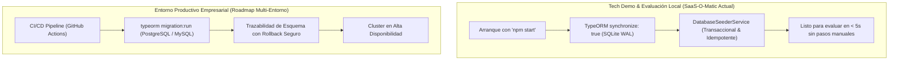
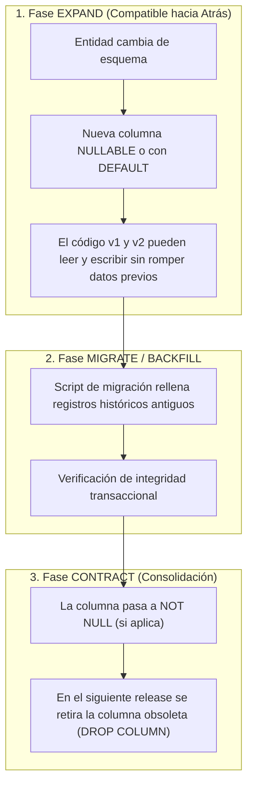
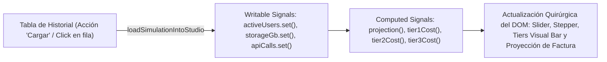
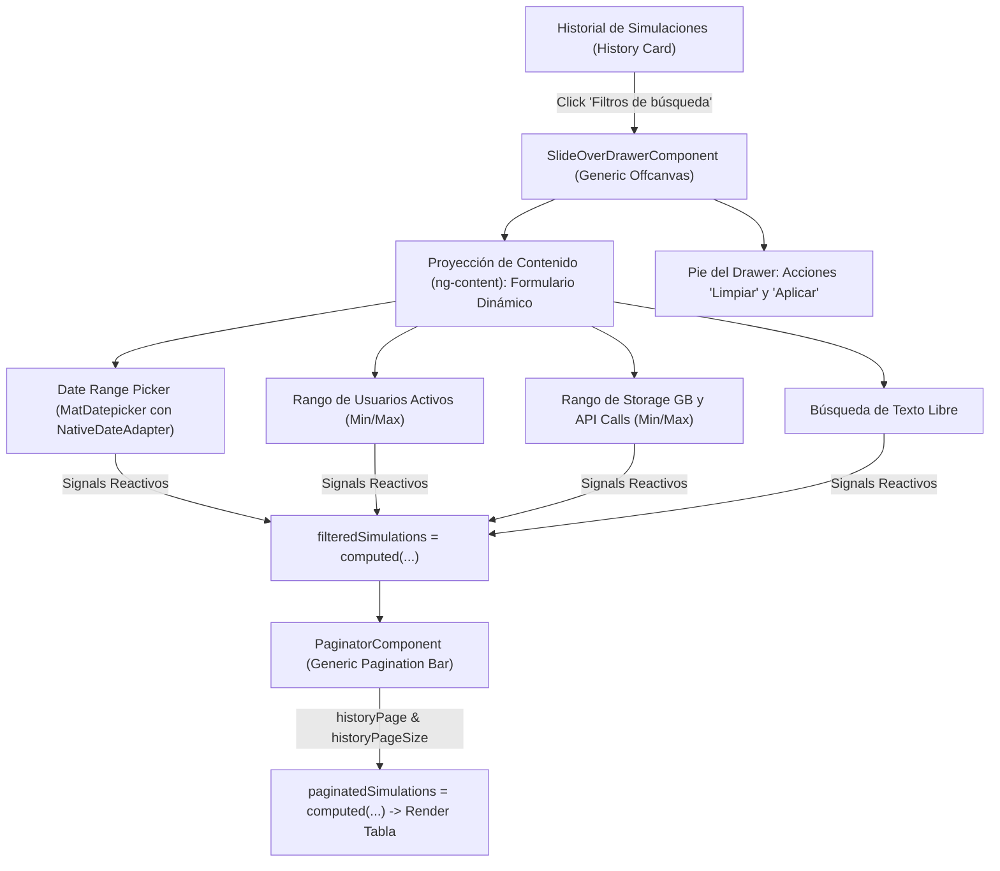
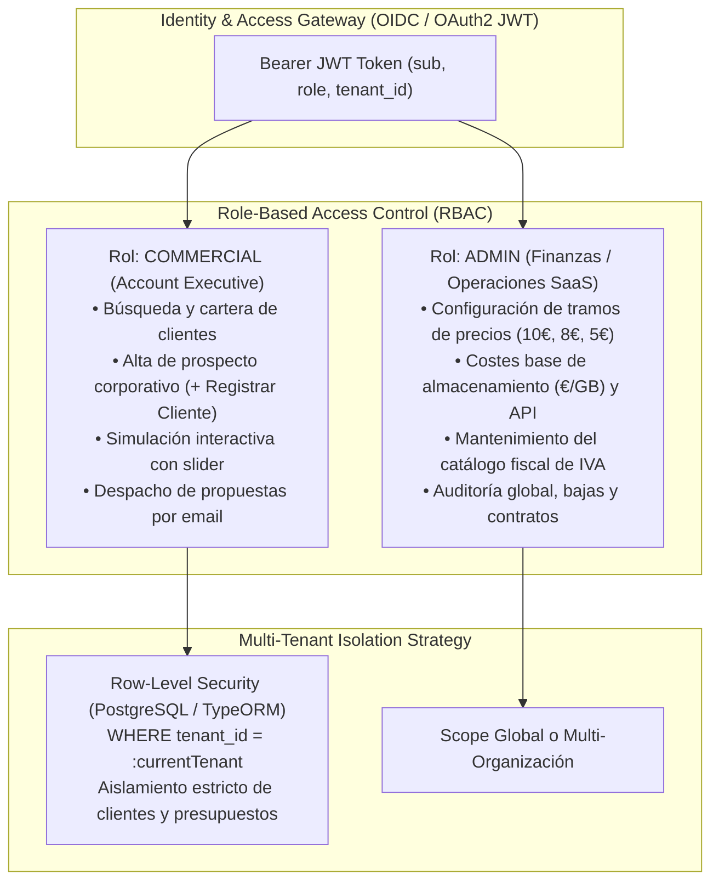

# SaaS-O-Matic: Directrices de Arquitectura Técnica
**Proyecto:** SaaS-O-Matic (Dynamic Billing & Subscription Optimizer)  
**Versión:** 1.0.0  
**Enfoque:** Clean Architecture / Hexagonal (Ports & Adapters) + Reactive Frontend (Signals)  
**Pila Tecnológica:** Backend NestJS (TypeScript + SQLite + TypeORM) | Frontend Angular 21 (Standalone + Signals)  

---

## 1. Principios de Diseño y Filosofía del Sistema

Para garantizar mantenibilidad, testabilidad y aislamiento estricto de las reglas de negocio, SaaS-O-Matic sigue los principios de **Arquitectura Hexagonal (Puertos y Adaptadores)** en el backend y un **patrón reactivo unidireccional impulsado por Signals** en el frontend.

### Reglas de Oro de Arquitectura
1. **El Dominio es Inmaculado:** El núcleo de negocio se implementa en TypeScript puro. No contiene dependencias, librerías externas ni decoradores de frameworks (`@Injectable`, `@Entity`, `@Column`, `@Get`, etc.).
2. **Inversión de Dependencias (DIP) y Nomenclatura Explícita:** 
   - `application/ports/in/`: Contratos de casos de uso ejecutados por los adaptadores primarios.
   - `application/ports/out/`: Contratos de persistencia/servicios externos requeridos por la aplicación.
   - `infrastructure/adapters/in/rest/`: Controladores NestJS y DTOs HTTP.
   - `infrastructure/adapters/out/persistence/`: Entidades y repositorios TypeORM/SQLite.
3. **Módulo como Orquestador (Wiring):** Los archivos de módulo de NestJS (`customers.module.ts`, `simulations.module.ts`) residen en la raíz de cada módulo para actuar como orquestadores de las tres capas (dominio, aplicación e infraestructura).
4. **Capa Transversal (`src/shared/`):** La carpeta `shared/` se sitúa en la raíz de `src/`, fuera de `modules/`, agrupando excepciones genéricas de dominio y filtros globales como el manejador RFC 7807.
5. **Código en Inglés, Documentación en Español:** Nombres de clases, variables, interfaces, tests y commits se escriben en inglés canónico. La documentación, explicaciones y bitácoras se redactan en español.
6. **Estandarización de Errores:** Ninguna excepción interna escapa sin ser transformada al estándar **IETF RFC 7807 Problem Details** (`application/problem+json`).
7. **Soberanía del Dominio sobre Fechas y Precisión Financiera:**
   - Las entidades de dominio originan y gobiernan sus propios timestamps (`createdAt: new Date()`). En infraestructura, TypeORM utiliza `@Column('datetime')` en lugar de `@CreateDateColumn` para no sobrescribir ni desincronizar los ciclos de vida del dominio.
   - Todo importe monetario se persiste con `@Column('decimal', { precision: 10, scale: 2 })` (y `scale: 4` en tasas) para prevenir errores de coma flotante IEEE 754 de los tipos `float`.
8. **Concurrencia de Base de Datos en Modo WAL (Write-Ahead Logging):** Para garantizar alto rendimiento y evitar contención en SQLite, la persistencia se configura con `enableWAL: true`. En modo WAL, las lecturas no bloquean a las escrituras y las escrituras no bloquean a las lecturas, permitiendo que múltiples usuarios consulten clientes mientras se registran simulaciones concurrentes.
9. **Autoridad Fiscal del Servidor y Principio Open/Closed en Tarifas (Pricing Governance):**
   - El frontend comercial solo tiene potestad para manipular variables de volumen (`activeUsers`, `storageGb`, `apiCalls`). Las tarifas y límites de los tramos (10 €, 8 €, 5 €) son inmutables en cliente y se gobiernan de forma autoritativa en el backend para prevenir manipulaciones de precios y garantizar coherencia con la política financiera de la compañía.
   - El motor de tarificación (`calculateTieredPrice`) desacopla el algoritmo acumulativo de la matriz de precios (`PRICING_TIERS`), cumpliendo el principio **Open/Closed (OCP)**: si en el futuro la empresa modifica una tarifa (ej. subir el Tramo 3 de 5 € a 6 €) o añade un cuarto tramo corporativo, el motor no requiere reescritura de código, sino únicamente actualizar la tupla central de configuración fiscal.


---

## 2. Arquitectura del Backend (NestJS + TypeScript)

### 2.1 Modelo de Capas Hexagonales

```
┌────────────────────────────────────────────────────────────────────────┐
│                          INFRASTRUCTURE LAYER                          │
│  ┌───────────────────────────────┐  ┌───────────────────────────────┐  │
│  │ Primary Adapters (in/rest):   │  │ Secondary Adapters (out/db):  │  │
│  │ - NestJS Controllers          │  │ - TypeORM Entities            │  │
│  │ - HTTP DTOs & Pipes           │  │ - SQLite Persistence Adapters │  │
│  │ - REST Mappers                │  │ - Persistence Mappers         │  │
│  └───────────────┬───────────────┘  └───────────────▲───────────────┘  │
└──────────────────┼──────────────────────────────────┼──────────────────┘
                   │                                  │ Implements
                   ▼ Calls In-Ports                   │ Out-Ports
┌─────────────────────────────────────────────────────┴──────────────────┐
│                           APPLICATION LAYER                            │
│  - Ports In:  Use Case Interfaces (e.g., CreateCustomerUseCase)        │
│  - Ports Out: Repository Interfaces (e.g., CustomerRepositoryPort)     │
│  - Services:  Use Case Orchestration Services                          │
└──────────────────────────────────┬─────────────────────────────────────┘
                                   │ Orchestrates
                                   ▼
┌────────────────────────────────────────────────────────────────────────┐
│                             DOMAIN LAYER                               │
│       (Pure TypeScript - Zero Framework & Zero DB Dependencies)        │
│  - Entities: Customer, Simulation                                      │
│  - Value Objects: TaxId, CountryCode                                   │
│  - Domain Services: PricingEngineService, SpanishFiscalValidator       │
│  - Domain Exceptions: InvalidFiscalIdException, etc.                   │
└────────────────────────────────────────────────────────────────────────┘
```

---

### 2.2 Estructura Canónica de Directorios del Backend (`mic-saas-omatic/`)

```text
mic-saas-omatic/
├── src/
│   ├── modules/
│   │   ├── customers/
│   │   │   ├── domain/                                      # DOMINIO PURO
│   │   │   │   ├── entities/
│   │   │   │   │   └── customer.entity.ts
│   │   │   │   ├── value-objects/
│   │   │   │   │   └── tax-id.vo.ts                         # Normalización y validación
│   │   │   │   ├── services/
│   │   │   │   │   └── spanish-fiscal.validator.ts          # Algoritmos DNI / NIE / CIF
│   │   │   │   └── exceptions/
│   │   │   │       ├── invalid-fiscal-id.exception.ts
│   │   │   │       ├── customer-not-found.exception.ts
│   │   │   │       └── customer-conflict.exception.ts
│   │   │   ├── application/                                 # APLICACIÓN
│   │   │   │   ├── ports/
│   │   │   │   │   ├── in/                                  # Casos de uso (interfaces)
│   │   │   │   │   │   ├── create-customer.use-case.ts
│   │   │   │   │   │   ├── list-customers.use-case.ts
│   │   │   │   │   │   └── get-customer-detail.use-case.ts
│   │   │   │   │   └── out/                                 # Repositorios (interfaces)
│   │   │   │   │       └── customer-repository.port.ts
│   │   │   │   └── services/                                # Implementación de casos de uso
│   │   │   │       └── customer-application.service.ts
│   │   │   ├── infrastructure/                              # INFRAESTRUCTURA
│   │   │   │   └── adapters/
│   │   │   │       ├── in/
│   │   │   │       │   └── rest/
│   │   │   │       │       ├── customer.controller.ts
│   │   │   │       │       ├── dto/
│   │   │   │       │       │   ├── create-customer.dto.ts
│   │   │   │       │       │   └── customer-response.dto.ts
│   │   │   │       │       └── customer-rest.mapper.ts
│   │   │   │       └── out/
│   │   │   │           └── persistence/
│   │   │   │               ├── customer.typeorm-entity.ts
│   │   │   │               ├── customer-persistence.adapter.ts
│   │   │   │               └── customer-persistence.mapper.ts
│   │   │   └── customers.module.ts                          # Ensamblaje / Wiring del módulo
│   │   │
│   │   └── simulations/
│   │       ├── domain/                                      # DOMINIO PURO
│   │       │   ├── entities/
│   │       │   │   └── simulation.entity.ts
│   │       │   ├── services/
│   │       │   │   ├── pricing-engine.service.ts            # Tramos acumulativos
│   │       │   │   └── tax-calculator.service.ts            # Matriz de impuestos y reverse charge
│   │       │   └── exceptions/
│   │       │       └── invalid-simulation-metric.exception.ts
│   │       ├── application/                                 # APLICACIÓN
│   │       │   ├── ports/
│   │       │   │   ├── in/
│   │       │   │   │   └── create-simulation.use-case.ts
│   │       │   │   └── out/
│   │       │   │       └── simulation-repository.port.ts
│   │       │   └── services/
│   │       │       └── simulation-application.service.ts
│   │       ├── infrastructure/                              # INFRAESTRUCTURA
│   │       │   └── adapters/
│   │       │       ├── in/
│   │       │       │   └── rest/
│   │       │       │       ├── simulation.controller.ts
│   │       │       │       ├── dto/
│   │       │       │       │   ├── create-simulation.dto.ts
│   │       │       │       │   └── simulation-response.dto.ts
│   │       │       │       └── simulation-rest.mapper.ts
│   │       │       └── out/
│   │       │           └── persistence/
│   │       │               ├── simulation.typeorm-entity.ts
│   │       │               ├── simulation-persistence.adapter.ts
│   │       │               └── simulation-persistence.mapper.ts
│   │       └── simulations.module.ts                        # Ensamblaje / Wiring del módulo
│   │
│   ├── shared/                                              # TRANSVERSAL GLOBAL
│   │   ├── domain/
│   │   │   └── domain.exception.ts
│   │   └── infrastructure/
│   │       ├── filters/
│   │       │   └── problem-detail-exception.filter.ts       # Filtro global RFC 7807
│   │       └── persistence/
│   │           └── typeorm-sqlite.config.ts
│   │
│   ├── app.module.ts
│   └── main.ts
├── test/
├── jest.config.ts
├── package.json
└── tsconfig.json
```

### 2.3 Decisiones de Rendimiento y Concurrencia (Evaluación de Palancas Enterprise)

Frente a modelos como Java/Spring Boot (que requieren habilitar Virtual Threads para evitar la saturación del modelo thread-per-request), Node.js opera de forma asíncrona no bloqueante mediante el Event Loop. No obstante, se han evaluado las 3 palancas clásicas de rendimiento en backend:

| Palanca de Rendimiento | Decisión | Justificación Técnica Senior |
| :--- | :---: | :--- |
| **A. Motor HTTP (Fastify vs Express)** | **Descartada** (Se mantiene Express) | NestJS incluye Express por defecto, capaz de procesar >10.000 req/s. Migrar a Fastify añadiría complejidad innecesaria sin aportar beneficio medible al volumen de uso comercial interno. |
| **B. Concurrencia SQLite (Modo WAL)** | **APLICADA** (`enableWAL: true`) | SQLite por defecto usa *Rollback Journal*, bloqueando a los lectores durante las escrituras. Con WAL (*Write-Ahead Logging*), las lecturas concurrentes nunca bloquean las escrituras ni viceversa. |
| **C. Multi-núcleo / Clustering** | **Descartada** (1 proceso Node.js) | En entornos con SQLite como base de datos embebida monoproceso, levantar múltiples procesos Node.js compitiendo por el archivo bloquea el driver. Un único proceso Node.js con `better-sqlite3` es la arquitectura óptima. |

### 2.4 Gestión de Configuración Multi-entorno y Variables de Entorno

Siguiendo el estándar *The Twelve-Factor App* (Factor III: Configuración):
1. **Backend (`mic-saas-omatic`):**
   - Soporte nativo de ficheros `.env` mediante `process.loadEnvFile()` de Node.js 20.6+ sin librerías externas superfluas.
   - Plantilla versionada [`.env.example`](../../mic-saas-omatic/.env.example) y valores por defecto tolerantes a fallos (`PORT: 3000`, `DATABASE_NAME: saas_o_matic.sqlite`).
2. **Frontend (`spa-saas-omatic`):**
   - Desacoplamiento de entorno cliente mediante Angular `src/environments/` (`environment.ts` para producción y `environment.development.ts` para desarrollo local).
   - Inyección de dependencias centralizada: ningún servicio o componente consume URLs literales.
3. **Orquestación Global (Docker Compose):**
   - Plantilla [`.env.example`](../../.env.example) en la raíz para unificar los puertos de publicación y las rutas de base de datos entre contenedores.

### 2.5 Filtrado Server-Side Completo vs. Client-Side (Consistencia de Paginación y Rendimiento SQL)

En sistemas empresariales escalables, el filtrado de entidades de negocio (**empresa, identificador fiscal, email y jurisdicción fiscal por país**) debe ejecutarse obligatoriamente en el **Backend (Server-Side)**:
1. **Fallo de Consistencia en Paginación (*Pagination Loss*):**
   Si la API pagine los clientes (ej. `LIMIT 20 OFFSET 0`) y el frontend filtra en memoria con un `.filter()`, el cliente solo ve los registros de ese país presentes en la página actual (ej. 1 solo resultado), ignorando decenas de coincidencias que residen en las páginas 2, 3 o 10. Al filtrar en el motor de base de datos (`WHERE country = :country`), la consulta devuelve exactamente el conjunto íntegro de resultados coincidentes.
2. **Eficiencia de Red y CPU Cliente:**
   Un catálogo con miles de clientes corporativos saturaría el ancho de banda y la memoria del navegador si exigiera transferir un payload masivo completo. La base de datos resuelve las cláusulas combinadas `LIKE` y equality (`WHERE (company_name LIKE :term OR tax_id LIKE :term) AND country = :country`) en milisegundos mediante índices B-Tree optimizados.
3. **Arquitectura Hexagonal Limpia:**
   - **Inbound Controller:** Recibe query params opcionales `@Query('search') search?: string, @Query('country') country?: string`.
   - **Use Case:** Orquesta la llamada pasando ambos criterios de forma desacoplada al puerto de salida.
   - **Outbound Persistence Adapter:** Compone dinámicamente las ramas `where` de TypeORM según los filtros activos (`ALL`, país específico, búsqueda textual o ambos combinados) ordenando por `createdAt DESC`.

### 2.6 Proyecciones Ligeras de Lectura (Read-Model Projections / Sparse Fieldsets)

Para evitar el anti-patrón de *Over-Fetching* (descarga masiva de atributos irrelevantes para una vista concreta) y acelerar los tiempos de respuesta:
1. **Segregación por Caso de Uso (CQRS-Lite):**
   - **Dashboard Ejecutivo (`/home`):** Demanda una visualización ágil de clientes recientes orientada a la acción inmediata (*Fast-Track Action*). Solo requiere identificar la empresa y su país para lanzar una simulación.
   - **Directorio Completo (`/customers`):** Requiere la entidad enriquecida (`CustomerResponseDto` con NIF/CIF fiscal, email de contacto y plan asignado).
2. **DTO Proyectado (`CustomerLiteResponseDto`):**
   - El endpoint `GET /customers?fields=lite` devuelve exclusivamente `{ id, companyName, country }`.
   - Reduce el tamaño del JSON en más de un **70%** (de ~250 B a ~65 B por cliente), agilizando el parsing del navegador y reduciendo drásticamente el consumo de datos móviles.
   - Preserva la emisión de la cabecera `X-Total-Count`, permitiendo al frontend actualizar los contadores KPI y obtener los registros compactos en una sola petición HTTP.

### 2.7 Validación Permisiva de Identificadores UUID RFC y Resiliencia en DTOs

En microservicios orientados a la integración con diversos subsistemas empresariales o bases de datos heredadas, la validación estricta de UUIDs v4 mediante `@IsUUID('4')` introduce fragilidad operacional:
- **Problema Detectado:** Determinados identificadores UUID válidos según la norma IETF RFC 4122 (versiones 1 a 5) o fixtures de inicialización pueden no presentar el dígito `4` en el nibble de versión, provocando respuestas `400 Bad Request` artificiales en peticiones legítimas como `POST /simulations`.
- **Solución Arquitectónica:** En `CreateSimulationDto`, se sustituye la restricción rígida por una validación estándar basada en la especificación formal del formato UUID de 36 caracteres:
  ```typescript
  @Matches(
    /^[0-9a-fA-F]{8}-[0-9a-fA-F]{4}-[0-9a-fA-F]{4}-[0-9a-fA-F]{4}-[0-9a-fA-F]{12}$/,
    { message: 'customerId must be a valid UUID format (8-4-4-4-12 hex string).' },
  )
  readonly customerId!: string;
  ```
- **Beneficio Senior:** Acepta sin fricción cualquier UUID canónico (RFC 4122 v1, v3, v4, v5) y los modernos identificadores ordenados temporalmente (RFC 9562 UUIDv7), garantizando interoperabilidad y eliminando falsos positivos de validación.

### 2.8 Estrategia de Persistencia: SQLite WAL + Seeder Idempotente frente a Migraciones en Producción

Ante la necesidad de gestionar la evolución del esquema relacional en bases de datos, surgen dos enfoques arquitectónicos con compromisos técnicos diferenciados:



#### A. Por qué SQLite WAL + Seeder Idempotente es la Elección Óptima para esta Tech Demo
1. **Experiencia de Evaluación Cero-Fricción (*Frictionless DX*):** Un evaluador técnico debe poder clonar el repositorio y ejecutar `npm start` viendo la base de datos lista con 18 clientes y simulaciones sin requerir pasos manuales previos como `npm run typeorm:migration:run`.
2. **Concurrencia con SQLite WAL (`enableWAL: true`):** El modo Write-Ahead Logging permite lecturas y escrituras simultáneas en archivos `.sqlite` locales sin contención ni bloqueos de base de datos.
3. **Idempotencia Garantizada:** `DatabaseSeederService` comprueba la existencia de registros antes de insertar (`count === 0`), previniendo duplicados ante reinicios sucesivos del servidor.

#### B. Cuándo y Por Qué Implementar Migraciones Formales en Producción
- En entornos con bases de datos como PostgreSQL o MySQL en clúster, `synchronize: true` está terminantemente prohibido porque podría alterar tablas con millones de transacciones.
- Las migraciones explícitas versionadas (`typeorm migration:generate` y `typeorm migration:run`) permiten auditoría de cambios DDL en Git, control granular de índices y ejecución de scripts de reversión (*rollback*) ante incidencias en despliegues automatizados.

#### C. Guía de Evolución de Esquemas, Migraciones y Compatibilidad hacia Atrás (Data Compatibility)

Cuando un sistema SaaS evoluciona (modificación de nombres de columnas, alteración de tipos de datos, o adición de nuevas restricciones fiscales), surge la necesidad crítica de preservar la integridad y compatibilidad de los datos ya persistidos:



1. **Particularidades del Motor SQLite frente a RDBMS Tradicionales:**
   - Motores como PostgreSQL o MySQL soportan operaciones DDL avanzadas (`ALTER TABLE ... ALTER COLUMN TYPE ...`).
   - SQLite, por su arquitectura embebida y tipado dinámico (*type affinity*), tiene restricciones históricas sobre `ALTER TABLE`. Aunque versiones modernas (SQLite $\ge$ 3.25 / 3.35) soportan `RENAME COLUMN` y `DROP COLUMN`, cambios complejos en tipos de datos requieren la técnica canónica:
     - Crear tabla temporal con el nuevo esquema (`CREATE TABLE customers_backup (...)`).
     - Copiar los datos transformados (`INSERT INTO customers_backup SELECT ... FROM customers`).
     - Eliminar la tabla antigua (`DROP TABLE customers`).
     - Renombrar la tabla temporal (`ALTER TABLE customers_backup RENAME TO customers`).
     - Recrear índices y triggers en una única transacción atómica (`BEGIN TRANSACTION ... COMMIT`).

2. **Comportamiento en Desarrollo Local con TypeORM (`synchronize: true`):**
   - En desarrollo y en esta tech demo, `synchronize: true` compara las entidades ORM (`CustomerOrmEntity`, `SimulationOrmEntity`) contra el archivo SQLite en disco.
   - **Adición de Columnas:** Si se añade una columna `@Column({ nullable: true })` o `@Column({ default: 'STANDARD' })`, TypeORM emite automáticamente un `ALTER TABLE ADD COLUMN`, preservando intactos todos los clientes y simulaciones ya guardados.
   - **Regla de Oro:** Para mantener compatibilidad con los datos existentes en SQLite, **nunca debe añadirse una columna `NOT NULL` sin un valor `default`**, ya que de lo contrario SQLite rechazaría la inserción sobre filas preexistentes.

3. **Arquitectura Formal de Migraciones para Producción (Enterprise Pipeline):**
   Para entornos productivos con PostgreSQL/MySQL, el microservicio define la infraestructura necesaria mediante TypeORM CLI:
   - **Configuración de DataSource (`src/data-source.ts`):** Centraliza la conexión, entidades y el array de migraciones en `src/infrastructure/adapters/out/persistence/migrations/*.ts`.
   - **Flujo de Comandos Canónico:**
     ```bash
     # 1. Generar automáticamente una migración diferencial detectando cambios en entidades:
     npx typeorm-ts-node-commonjs migration:generate src/infrastructure/adapters/out/persistence/migrations/UpdateCustomerFiscalData -d src/data-source.ts
     
     # 2. Ejecutar las migraciones pendientes en la canalización CI/CD de despliegue:
     npx typeorm-ts-node-commonjs migration:run -d src/data-source.ts
     
     # 3. Revertir la última migración ante una incidencia operacional:
     npx typeorm-ts-node-commonjs migration:revert -d src/data-source.ts
     ```

4. **El Patrón Expand / Contract (Zero-Downtime Schema Evolution):**
   - En despliegues continuos (Blue/Green o Canary), durante unos minutos conviven instancias del servidor con la versión anterior del código (v1) y la nueva versión (v2).
   - Aplicar el patrón **Expand/Contract** garantiza que:
     - Ninguna fila existente sufra pérdida de datos (*Data Loss*).
     - La versión v1 pueda seguir operando sin lanzar excepciones de columna inexistente.
     - Los clientes antiguos se migren progresivamente sin interrumpir el servicio comercial.

5. **Mecanismo de Reseteo Rápido en Tech Demo:**
   - Si durante pruebas locales el evaluador desea forzar un borrado completo del esquema para probar el seeder desde cero, basta con ejecutar `npm --prefix mic-saas-omatic run seed` o eliminar el archivo `saas_o_matic.sqlite`. En el siguiente arranque (`npm start`), `DatabaseSeederService` re-creará las tablas e inyectará los 18 clientes corporativos con CIFs válidos.

---

## 3. Arquitectura del Frontend (Angular 22)

### 3.1 Patrón Arquitectónico: Componentes Standalone y Signals

```text
spa-saas-omatic/
├── src/
│   ├── app/
│   │   ├── core/                                            # Infraestructura transversal de la aplicación
│   │   │   ├── errors/
│   │   │   │   ├── problem-detail.model.ts                  # Formato estándar de error RFC 7807 (application/problem+json)
│   │   │   │   └── error.interceptor.ts                     # HttpInterceptor funcional global (normaliza errores a ProblemDetail)
│   │   │   ├── i18n/
│   │   │   │   └── translations.ts                          # Catálogo de traducciones bilingüe (es/en) fuertemente tipado
│   │   │   ├── models/
│   │   │   │   └── currency.model.ts                        # CurrencyCode (as const), CURRENCY_METADATA, DEFAULT_FALLBACK_RATES y ExchangeRateApiResponse (SSOT)
│   │   │   └── services/
│   │   │       ├── currency.service.ts                      # Integración open.er-api.com, caché en memoria y Signals
│   │   │       └── i18n.service.ts                          # Servicio reactivo de localización con Signals y detección de navegador
│   │   │
│   │   ├── modules/                                         # Módulos de dominio funcionales (Simetría 1:1 con backend)
│   │   │   ├── customers/                                   # Bounded Context de Clientes (modules/customers)
│   │   │   │   ├── models/
│   │   │   │   │   └── customer.model.ts                    # Customer y CustomerCreate
│   │   │   │   ├── services/
│   │   │   │   │   └── customer-api.service.ts              # GET /customers, GET /customers/:id
│   │   │   │   ├── components/
│   │   │   │   │   ├── customer-card/                       # Dumb Component: tarjeta responsive
│   │   │   │   │   └── customer-search-bar/                 # Dumb Component: input con debounce
│   │   │   │   └── pages/
│   │   │   │       ├── customer-list/                       # Smart Page: buscador y grid de clientes
│   │   │   │       └── customer-detail/                     # Smart Page: ficha + historial + simulación
│   │   │   │
│   │   │   └── simulations/                                 # Bounded Context de Simulaciones (modules/simulations)
│   │   │       ├── models/
│   │   │       │   └── simulation.model.ts                  # Simulation, SimulationCreate y SimulationProjection
│   │   │       ├── services/
│   │   │       │   └── simulation-api.service.ts            # POST /simulations, GET /simulations?customerId=
│   │   │       ├── utils/
│   │   │       │   └── local-pricing-calculator.ts          # Proyección local inmediata de tramos en slider
│   │   │       └── components/
│   │   │           ├── simulation-slider/                   # Dumb Component: control interactivo accesible
│   │   │           ├── simulation-projection/               # Dumb Component: desglose de costes en vivo
│   │   │           └── simulation-history-list/             # Dumb Component: tabla/cards de simulaciones
│   │   │
│   │   ├── shared/                                          # Componentes UI reutilizables
│   │   │   ├── components/
│   │   │   │   ├── navbar/                                  # Navbar corporativa estilo Roams
│   │   │   │   ├── currency-selector/                       # Selector EUR, USD, GBP con Signal reactivo
│   │   │   │   ├── language-selector/                       # Menú flotante mat-menu con flags y OCP
│   │   │   │   ├── loading-state/                           # Estado de carga accesible reutilizable
│   │   │   │   └── error-banner/                            # Banner visual renderizador de RFC 7807
│   │   │   └── pipes/
│   │   │       ├── localized-currency.pipe.ts               # Pipe i18n con Intl.NumberFormat y metadatos nativos por país
│   │   │       └── translate.pipe.ts                        # Pipe declarativo de traducción reactiva con Signals
│   │   │
│   │   ├── app.ts                                           # Shell de aplicación con Standalone Components
│   │   ├── app.html                                         # Layout con Navbar + <router-outlet />
│   │   ├── app.config.ts                                    # Configuración global (provideHttpClient, Router)
│   │   └── app.routes.ts                                    # Configuración de rutas con Lazy Loading
│   ├── index.html
│   ├── styles/                                              # Arquitectura modular SCSS (Patrón 7-1)
│   │   ├── _colors.scss                                     # Paleta corporativa Roams + Design Tokens :root
│   │   └── _variables.scss                                  # Radios y elevación de sombras
│   └── styles.scss                                          # Orquestador SCSS raíz (@use 'colors', 'variables')
├── angular.json
├── package.json
└── tsconfig.json
```

### 3.2 Sistema de Diseño, UI y Design Tokens Corporativos (Angular Material + SCSS Modular)
- **UI Framework:** Angular Material. Se elige porque el Dashboard necesita slider, formularios, select de divisa y tarjetas con accesibilidad nativa (a11y) y componentes probados desde el minuto uno, sin tener que construir el slider desde cero.
- **Arquitectura Modular de Estilos SCSS (Patrón 7-1 / Single Source of Truth):**
  En lugar de mezclar declaraciones de diseño en el archivo global `styles.scss`, los estilos se desacoplan en parciales dedicados con responsabilidad única:
  - `src/styles/_colors.scss`: Define las variables SCSS (`$roams-*`) y proyecta el catálogo de Design Tokens a variables CSS Custom Properties (`--roams-*`) en `:root`.
  - `src/styles/_variables.scss`: Centraliza radios de curvatura (`--roams-radius-*`) y matrices de elevación y sombra (`--roams-shadow-*`).
  - `src/styles.scss`: Actúa exclusivamente como orquestador raíz limpio, importando los parciales mediante `@use './styles/colors'` y `@use './styles/variables'`.
  - `angular.json`: Se configura `stylePreprocessorOptions.includePaths: ["src/styles"]`, permitiendo a cualquier componente importar `@use 'colors'` directamente sin rutas relativas frágiles (`../../styles`).
- **Design Tokens Corporativos Roams (`--roams-*`):** Inspirados en la identidad visual de `roams.es`, en `_colors.scss` se centraliza la paleta corporativa completa como Única Fuente de Verdad (SSOT):
  - **Identidad de Marca:**
    - `--roams-primary`: `#0F172A` (Azul marino profundo cabecera / fondo oscuro)
    - `--roams-primary-light`: `#1E293B` (Pizarra oscuro para contrastes y degradados)
    - `--roams-primary-dark`: `#090D16` (Azul marino ultra oscuro para sombras y profundidad)
    - `--roams-accent-blue`: `#1061E2` (Azul real Roams de acción y foco)
    - `--roams-accent-blue-hover`: `#0D4EB8` (Azul real hover/active)
    - `--roams-accent-cyan`: `#0EA5E9` (Cian de acento y feedback interactivo)
    - `--roams-accent-purple`: `#8B5CF6` (Púrpura institucional para planes Enterprise)
  - **Estados y Feedback:**
    - `--roams-status-success`: `#10B981` (Verde esmeralda para ahorros, sincronización y estado activo)
    - `--roams-status-warning`: `#F59E0B` (Ámbar de contingencia y alertas)
    - `--roams-status-error`: `#EF4444` (Rojo de error RFC 7807)
    - `--roams-status-info`: `#0EA5E9` (Cian de sincronización en vivo)
  - **Superficies y Fondos:**
    - `--roams-bg-page`: `#F8FAFC` (Lienzo general)
    - `--roams-bg-card` / `--roams-surface`: `#FFFFFF` (Superficies de tarjetas, paneles y diálogos)
    - `--roams-bg-input-dark`: `rgba(255, 255, 255, 0.1)` (Campos translúcidos sobre barra oscura)
  - **Tipografía y Contraste:**
    - `--roams-text-primary`: `#0F172A` (Texto principal de alta legibilidad)
    - `--roams-text-secondary`: `#64748B` (Texto secundario, metadatos y etiquetas)
    - `--roams-text-muted`: `#94A3B8` (Texto atenuado, placeholders y capturas)
    - `--roams-text-inverse`: `#FFFFFF` (Texto blanco sobre fondos oscuros o botones)
    - `--roams-text-inverse-muted`: `rgba(255, 255, 255, 0.7)` (Texto atenuado sobre fondos oscuros)
  - **Bordes y Divisores:**
    - `--roams-border`: `#E2E8F0` (Borde sutil para tarjetas y contenedores)
    - `--roams-border-light`: `#F1F5F9` (Separadores internos de listas y pie de página)
    - `--roams-border-inverse`: `rgba(255, 255, 255, 0.2)` (Borde sutil para inputs oscuros)
  - **Geometría y Elevación:**
    - `--roams-radius-sm`: `8px`, `--roams-radius-md`: `12px`, `--roams-radius-lg`: `16px`.
    - `--roams-shadow-sm`, `--roams-shadow-md`, `--roams-shadow-lg`.
- **Cascada Nativa, Cero Hardcodeo y Prohibición de Fallbacks Hexadecimales:**
  - Queda terminantemente prohibido incluir valores hexadecimales directos (`#1061e2`, `#64748b`, `#ffffff`) en los archivos `.scss` de los componentes.
  - **Regla estricta contra fallbacks en `var()`**: No se permiten declaraciones como `var(--roams-text-secondary, #64748b)` ni `var(--roams-accent-blue, #1061e2)`. Incluir códigos de color en el segundo parámetro de `var()` duplica la declaración de colores, crea múltiples fuentes de verdad no sincronizadas y rompe la capacidad del sistema para re-tematizarse dinámicamente.
  - La invocación debe ser estrictamente canónica: `color: var(--roams-text-secondary);`. Si se requiere el color en SCSS en tiempo de compilación (ej. para funciones `color.adjust()` o gradientes SCSS), se debe importar `@use 'colors' as c;` y consumir `$c.roams-*`.
- **Diseño Mobile-First y Responsividad Total:**
  - Toda la interfaz (Navbar, buscador, tarjetas, modal/vistas y slider) se diseña bajo enfoque **Mobile-First**: el layout base se concibe para pantallas móviles compactas (`320px` - `480px`), adaptándose de forma progresiva a tablets (`768px`) y escritorio (`1024px` - `1440px+`).
  - Empleo exclusivo de **CSS Flexbox y CSS Grid elástico** (`grid-template-columns: repeat(auto-fill, minmax(300px, 1fr))`), garantizando cero scrollbars horizontales no deseados (`overflow-x: hidden` en contenedor principal) y wrapping fluido de controles de acción.
  - Sin dependencias de frameworks CSS pesados (Bootstrap o Tailwind): 100% estilos nativos y Angular Material para mantener el bundle ultraligero (< 50 kB inicial).
- **Micro-interacciones y Animaciones Fluidas (Core Web Vitals):**
  - **Entrada suave de tarjetas:** Cada tarjeta `CustomerCard` entra con una animación suave de opacidad y desplazamiento (`opacity: 0 -> 1`, `translateY: 10px -> 0`) mediante aceleración Material `cubic-bezier(0.16, 1, 0.3, 1)` de 350ms, evitando apariciones bruscas.
  - **Feedback táctil en buscador:** El input de búsqueda muestra un `<mat-spinner diameter="18">` contextual durante el debounce y la petición, informando al usuario en su foco de visión.
  - **Transición no destructiva del Grid (`.is-searching`):** Mientras se filtra sobre resultados existentes, el grid atenúa su opacidad (`opacity: 0.45; transition: opacity 0.25s ease;`) en lugar de destruirse, erradicando el Cumulative Layout Shift (CLS).
  - **Blindaje de la Carga Inicial (`initialLoading`):** Se controla el estado de carga inicial para asegurar que el spinner central se muestra de forma limpia antes de renderizar el primer lote de datos, impidiendo destellos del estado vacío.
- **Virtualización Nativa del DOM para Grids Masivos (`content-visibility: auto`):**
  - En un Grid CSS elástico y responsive (`repeat(auto-fill, minmax(320px, 1fr))`), el uso de componentes tradicionales como `cdk-virtual-scroll-viewport` introduce serios problemas: está diseñado para listas unidimensionales de altura fija y genera saltos visuales (*glitches*) al variar el número de columnas según la pantalla.
  - Se adopta el estándar moderno de la W3C: `.customer-card { content-visibility: auto; contain-intrinsic-size: auto 240px; }`. El motor C++ del navegador omite de forma nativa el cálculo de layout, estilo y pintado de las tarjetas fuera del viewport. Si existen 5.000 clientes, el DOM solo procesa los 8-12 visibles en pantalla a 60 FPS estables sin dependencias JS pesadas.
- **Filtro de Jurisdicción Fiscal por País con Chips Reactivos (`Signals`):**
  - Respondiendo directamente al núcleo del reto de Roams (donde el país determina el impuesto aplicable: España 21%, Alemania 19%, Francia 20%, USA 0%), se implementa una barra de filtros de facetas: `[ 🌐 Todos (N) | 🇪🇸 ES (x) | 🇺🇸 US (y) | ... ]`.
  - Mediante señales computadas (`countryFilters = computed(...)` y `filteredCustomers = computed(...)`), los países presentes en el catálogo y sus recuentos se derivan reactivamente en memoria, permitiendo al comercial aislar clientes por jurisdicción fiscal de forma instantánea sin peticiones HTTP redundantes a la base de datos.
  - Accesibilidad semántica: implementado con `role="radiogroup"` y `role="radio"` con `aria-checked` para lectores de pantalla.

### 3.3 Estrategia de Divisas y Escalabilidad (Open/Closed Principle)

- **Caché Completa de la API:** La API externa (`https://open.er-api.com/v6/latest/EUR`) devuelve más de 160 tipos de cambio. `CurrencyService` almacena el diccionario completo en memoria (`rates`), por lo que la aplicación ya dispone de las tasas de cualquier divisa mundial sin peticiones HTTP adicionales.
- **Catálogo Controlado (UX Whitelist):** En lugar de abrumar al equipo comercial con 160 opciones en el desplegable, `SUPPORTED_CURRENCIES` acota el selector a las divisas operativas estratégicas del mercado SaaS (`EUR`, `USD`, `GBP`, `CHF`, `CAD`, `JPY`).
- **Extensibilidad Abierta/Cerrada:** Incorporar una nueva divisa comercial (ej. `AUD` o `MXN`) requiere únicamente añadir su código a la tupla `SUPPORTED_CURRENCIES`.
- **Formateo Universal con Fallback `Intl`:** Si se solicita formatear una divisa no registrada en `CURRENCY_METADATA`, el pipe `LocalizedCurrencyPipe` recurre de forma transparente al motor nativo `Intl.NumberFormat` de ECMAScript (`meta?.locale` y `meta?.decimals` como `undefined`), infiriendo automáticamente el símbolo oficial, el número canónico de decimales y el orden según el locale del navegador del usuario.

### 3.4 Estándares de Plantillas: Built-in Control Flow (`@if`, `@for`) y Pureza Declarativa (Dumb Templates)

Se prescribe el uso exclusivo del nuevo flujo de control nativo de Angular 22 y el principio estricto de **Plantillas Tontas (*Dumb Templates*)**:
- **`@if / @else if / @else`**: Sustituye a `*ngIf` con `<ng-template>`, permitiendo evaluar directamente las funciones de señales (`loading()`, `error()`) sin hacks reactivos.
- **`@for (...; track ...)`**: Sustituye a `*ngFor` y exige `track` obligatorio por compilador, garantizando una reconciliación quirúrgica del DOM sin destrucción de nodos.
- **Pureza Declarativa (Cero Lógica, Aritmética o Manipulación de Strings en HTML):**
  - **La regla:** El HTML solo responde a *¿QUÉ pinto y CUÁNDO lo pinto?*. El TypeScript responde a *¿CÓMO se calcula o se transforma?*.
  - **Prohibición de transformaciones inline:** Se prohíben manipulaciones de cadenas en el template (ej. `{{ name.charAt(0).toUpperCase() }}`) o concatenaciones de clases dinámicas (`'plan-' + plan.toLowerCase()`). En su lugar, se exponen señales computadas memoizadas en TS: `avatarInitial = computed(...)` y `planClass = computed(...)`.
  - **Prohibición de aritmética inline:** Se prohíbe el cálculo matemático en interpolaciones (ej. `(taxRate * 100).toFixed(0)` con aserciones no nulas `!`). En su lugar, se delega en señales computadas (`taxPercentage = computed(...)`) o en pipes puros nativos de Angular (`sim.taxRate | percent:'1.0-0'`), garantizando que la vista sea 100% declarativa, libre de errores en tiempo de ejecución y óptima en rendimiento a 60 FPS.
- **Descarte de `CommonModule`**: Cero dependencias de directivas estructurales legacy en componentes Standalone, optimizando el tamaño del bundle y el type-checking estricto de plantillas.

### 3.5 Internacionalización Reactiva y Desacoplamiento de Textos (`I18nService` + `TranslatePipe`)

Para mantener el principio de código en inglés y desacoplar la lógica de la presentación:
- **Cero Textos Hardcodeados:** Se prohíbe introducir cadenas literales de texto en clases TypeScript o plantillas HTML. Todas las etiquetas, tooltips y textos de accesibilidad (`aria-label`) se definen de forma centralizada en `src/app/core/i18n/translations.ts`.
- **Patrón Declarativo con Pipe (`TranslatePipe`):**
  En lugar de invocar métodos de servicio en las plantillas (`{{ i18n.t(...) }}`), se prescribe el uso del pipe reactivo `{{ 'clave' | translate }}`. Esto:
  1. Erradica la inyección obligatoria de `I18nService` en los componentes tontos (*Dumb Components*), manteniendo sus clases TypeScript limpias y libres de dependencias innecesarias.
  2. Sigue el estándar idiomático de Angular para i18n (familiar para evaluadores acostumbrados a *Transloco* o *ngx-translate*).
- **Tipado Estricto de Claves (`TranslationKey`):** El compilador de TypeScript valida que cualquier clave solicitada exista en el diccionario en ambos idiomas (`es` y `en`), previniendo erratas tipográficas en tiempo de compilación.
- **Detección Automática con Fallback Regional:** `I18nService` inspecciona `navigator.language` para adaptarse automáticamente a entornos internacionales, manteniendo el español (`'es'`) como idioma predeterminado de la plataforma.
- **Reactividad con Signals:** El idioma activo se almacena en una Signal `currentLanguage`, provocando el recálculo instantáneo de cualquier vista o mensaje reactivo sin necesidad de recargar la aplicación.
- **Escalabilidad de la UI y Desacoplamiento (Menú Desplegable `mat-menu` + `LanguageSelectorComponent`):**
  Para evitar que la barra de navegación colapse al incorporar nuevos idiomas ($\ge 3$ o $\ge 4$) y salvaguardar el principio *Mobile-First*, el selector de idioma se desacopla completamente del Navbar en su propio componente standalone (`src/app/shared/components/language-selector/`). Utiliza un menú flotante (`MatMenuModule`) con botón disparador de tamaño fijo (`[ 🇪🇸 ES ▾ ]`), desacoplando la cantidad de idiomas disponibles del espacio horizontal de la pantalla. Soporta de forma nativa cuádruple idioma (`Español` 🇪🇸, `English` 🇬🇧, `Deutsch` 🇩🇪, `Français` 🇫🇷) mediante la tupla centralizada `SUPPORTED_LANGUAGES`.
- **Patrón UX de Priorización del Idioma Activo (`sortedLanguages`):**
  Al abrir el menú desplegable de selección de idioma, el idioma actualmente activo se posiciona automáticamente en el primer lugar de la lista (`sortedLanguages = computed(...)`), seguido por el resto de opciones disponibles. Esto aporta confirmación visual inmediata del estado actual sin forzar al usuario a buscar o hacer scroll, mejorando la ergonomía táctil en dispositivos móviles.

#### 3.5.1 Deuda Técnica de la Edición Manual de Diccionarios y Solución Enterprise con TMS (Tolgee)

- **El Problema de la Gestión Manual de i18n (Archivos Estáticos en Git):**
  En pruebas de concepto o fases iniciales de un proyecto, mantener un objeto o archivo estático `translations.ts` o archivos JSON manuales en el repositorio Git es una solución rápida y autocontenida. Sin embargo, en un entorno empresarial de producción como el de Roams (con presencia o proyección en múltiples mercados europeos como España, Reino Unido, Alemania y Francia), este enfoque introduce **graves vicios y deuda técnica**:
  1. *El desarrollador como cuello de botella:* Cualquier corrección ortográfica, cambio comercial de copywriting o adaptación legal de términos exige crear ramas de Git, revisar Pull Requests, esperar a pipelines de CI/CD y desplegar una nueva versión de la aplicación.
  2. *Falta de contexto visual para traductores:* Los lingüistas o redactores reciben listas aisladas de claves (`customers.card.simulate.btn`) sin saber en qué pantalla aparecen, qué tamaño tienen o si el texto desbordará en pantallas móviles (*layout shift*).
  3. *Riesgo de corrupción sintáctica:* Traductores no técnicos que editan JSONs directamente suelen romper comillas, comas o caracteres escapados, provocando errores en tiempo de compilación.
  4. *Desincronización de claves entre idiomas:* A medida que el producto crece, es habitual olvidar traducir claves en alemán o francés, provocando huecos en la UI.

- **La Arquitectura Enterprise con un TMS Moderno: [Tolgee](https://tolgee.io):**
  La solución profesional consiste en desacoplar el contenido del código fuente mediante una plataforma de **Translation Management System (TMS)** como **Tolgee** (open-source, auto-hospedable o SaaS), integrándola en el ciclo de vida de desarrollo:

  ```
  ┌─────────────────────────────────────────────────────────────────────────────────┐
  │                           CI / CD & LOCAL WORKFLOW                              │
  └─────────────────────────────────────────────────────────────────────────────────┘
     [Frontend Code] ───────( tolgee push )────────> [ Tolgee Platform (TMS) ]
     (HTML/TS keys)                                   │  - Traductores & Copywriters
                                                      │  - Traducción asistida por IA
                                                      │  - Capturas & In-Context Preview
                                                      ▼
     [Production Build] <───( tolgee pull )────────── [ Exportación JSON Automática ]
     (assets/i18n/*.json)
  ```

  1. **Extracción y Subida Automatizada (`@tolgee/cli push`):**
     Los ingenieros desarrollan utilizando las claves semánticas. Un script en `package.json` o un hook de Git / GitHub Actions ejecuta el CLI de Tolgee para extraer automáticamente todas las claves nuevas de las plantillas y subirlas al servidor central de traducciones sin intervención manual:
     ```bash
     npx @tolgee/cli push --force-mode OVERRIDE
     ```
  2. **Traducción en Contexto (In-Context Translation con `@tolgee/ngx`):**
     En entornos de desarrollo y staging, Tolgee permite la traducción en vivo dentro de la propia aplicación Angular:
     - El traductor o product manager pulsa `Alt + Clic` sobre cualquier texto de la UI en su navegador (`localhost:4200` o entorno de pruebas).
     - Se abre un diálogo flotante donde edita el texto en caliente, ve el resultado instantáneamente y la herramienta captura automáticamente una captura de pantalla (*screenshot*) con el elemento resaltado.
     - Los traductores externos ven exactamente dónde se ubica cada botón, tarjeta o etiqueta y su restricción espacial.
  3. **Descarga y Empaquetado en Build (`@tolgee/cli pull`):**
     Antes de compilar la versión de producción (`ng build`), el pipeline de integración continua descarga de forma desatendida los archivos JSON finales validados por el equipo lingüístico directamente a la carpeta de assets:
     ```bash
     npx @tolgee/cli pull --path ./src/assets/i18n --format JSON
     ```
  4. **Scripts de Integración en `package.json`:**
     ```json
     {
       "scripts": {
         "i18n:push": "tolgee push --path ./src",
         "i18n:pull": "tolgee pull --path ./src/assets/i18n --format JSON",
         "i18n:sync": "tolgee sync --path ./src"
       }
     }
     ```
  5. **Carga Reactiva Asíncrona (HttpClient):**
     En lugar de importar un bundle estático en el archivo `.ts`, el servicio `I18nService` consume los JSON descargados mediante un `HttpBackend` o el SDK oficial `@tolgee/ngx`, permitiendo cargar bajo demanda (*Lazy Loading*) exclusivamente el paquete del idioma seleccionado por el usuario, reduciendo el bundle inicial transferido al cliente.

### 3.6 Standalone por Defecto (Angular 19+) y Eliminación de Boilerplate Redundante

- **Standalone Default:** A partir de Angular 19 (y ratificado en Angular 22), todos los decoradores `@Component`, `@Directive` y `@Pipe` son `standalone` por defecto (`standalone: true`).
- **Cero Boilerplate:** Se prohíbe escribir la propiedad redundante `standalone: true` en los metadatos de componentes, directivas o pipes. Únicamente en el caso excepcional de requerir integración con un `NgModule` legacy se especificaría de forma explícita `standalone: false`.
- **Imports Quirúrgicos:** Los componentes declaran en `imports: [...]` exclusivamente los componentes, pipes o módulos de Angular Material que consumen sus plantillas, evitando bundles inflados.

### 3.7 Principio YAGNI y Mantenibilidad: Códigos ISO Textuales vs. Mantenimiento de Banderas Cosméticas

- **La Decisión de Producto y Arquitectura (YAGNI):**
  - Mantener diccionarios o conversores algorítmicos de banderas emoji para cientos de países cliente en un sistema B2B introduce una deuda técnica innecesaria:
    1. *Inconsistencia de Plataforma:* Las banderas emoji no se renderizan en muchos sistemas operativos de escritorio (ej. Windows muestra códigos de letras `ES` en lugar de la bandera, Linux depende de fuentes de emojis instaladas y Android usa estilos dispares).
    2. *Mantenimiento Innecesario (YAGNI):* La prueba de Roams exige validar la jurisdicción fiscal del cliente (España, UE, fuera de UE), no construir un catálogo gráfico de banderas internacionales.
    3. *Claridad y Accesibilidad:* Los códigos ISO 3166-1 alpha-2 en texto claro (`ES`, `US`, `DE`) acompañados del icono semántico accesible `<mat-icon>public</mat-icon>` son universales, no sufren problemas tipográficos y transmiten la información fiscal de un vistazo.
- **Diferenciación con el Selector de Idioma de la Aplicación:**
  - Mientras que para los datos dinámicos de clientes se prescinde de banderas cosméticas en favor de texto ISO limpio, en el selector de idiomas de la barra de navegación (`LanguageSelectorComponent`) sí se emplean los 4 emojis específicos de los idiomas soportados (`🇪🇸 ES`, `🇬🇧 EN`, `🇩🇪 DE`, `🇫🇷 FR`) como convención visual de navegación de interfaz para el usuario.

### 3.8 Estándar de Iconografía y Accesibilidad (Ligaduras de Material Symbols y `aria-hidden`)

- **Componente Oficial `<mat-icon>`:** Se prescribe el uso exclusivo de `<mat-icon>` de Angular Material frente a etiquetas `<span>` genéricas.
- **Funcionamiento por Ligaduras OpenType:** Palabras clave en inglés como `search`, `close`, `mail` o `person_search` son ligaduras tipográficas que la fuente vectorial de Google sustituye por glifos en el canvas.
- **Accesibilidad Estricta (`aria-hidden="true"`):** Todo icono decorativo o acompañado de etiqueta descriptiva debe portar `aria-hidden="true"`. Esto previene que las tecnologías de asistencia para personas con discapacidad visual pronuncien la palabra técnica del icono (ej. "search") en lugar del texto accesible traducido (`[attr.aria-label]="'customers.search.aria' | translate"`).

### 3.9 Manejo Centralizado de Errores RFC 7807 (`errorInterceptor` vs. Servicios de Dominio)

- **Principio de Responsabilidad Única (SRP / DRY):**
  La transformación, captura y normalización de errores HTTP a objetos **RFC 7807** (`ProblemDetail`) pertenece exclusivamente a la capa de infraestructura transversal: **`errorInterceptor`** (`src/app/core/errors/error.interceptor.ts`).
- **Prohibición de Textos Hardcodeados y Fugas de Depuración:**
  1. Queda terminantemente prohibido incluir literales quemados en inglés (como `'An unexpected error occurred.'`) como valor por defecto en los servicios.
  2. Queda prohibido recurrir a `httpErr.message`, ya que Angular genera internamente cadenas técnicas en inglés (`"Http failure response for ..."`), ocultando las traducciones corporativas.
  3. Los fallbacks de contingencia ante caídas de red o fallos 500 no estructurados deben derivarse obligatoriamente de las claves centralizadas de `I18nService`: `'error.communication.title'` y `'error.communication.detail'`.
- **Servicios de Negocio Limpios:**
  Servicios como `CustomerApiService` y `SimulationApiService` reciben a través del flujo de RxJS el `ProblemDetail` ya garantizado y normalizado por el interceptor, limitándose a actualizar sus señales reactivas (`error.set(problem)`) sin duplicar lógica de parseo HTTP.

### 3.10 Aislamiento de Componentes Estéticos y Tolerancia a Fallos (Fault-Tolerant UI & Graceful Degradation)

Para garantizar que fallos en elementos cosméticos o de micro-interacción (spinners, animaciones, badges) jamás bloqueen la funcionalidad base ni la carga de datos del negocio:
1. **Inmunidad del Flujo de Datos:**
   El ciclo de vida de los datos (`CustomerApiService`, `HttpClient`, RxJS) opera de forma estrictamente desacoplada de la UI. La llamada a la base de datos y la actualización de las señales (`customers()`) no están atadas a si un componente visual se renderiza o no.
2. **Garantía Anti-Bloqueo de Carga (`finalize` en RxJS):**
   Toda señal de carga (`loading`) en los servicios de API se apaga obligatoriamente en el operador `finalize()`. Esto blinda al sistema contra "spinners infinitos": tanto si la petición es exitosa (`200`), como si falla con error (`400`, `500`), o se cancela, `loading` pasa inmediatamente a `false`, liberando la UI.
3. **Desacoplamiento Estricto de Componentes Presentacionales:**
   - Componentes como `<app-loading-state>` (`src/app/shared/components/loading-state/`) o `<mat-spinner>` son puramente tontos (*Dumb Components*): reciben inputs primitivos (`message`, `diameter`) y carecen de efectos secundarios (*Zero Side Effects*).
   - El spinner del buscador (`CustomerSearchBarComponent`) es un adorno visual en el sufijo del input: el pipeline reactivo de filtrado (`Subject -> debounceTime -> emit`) corre en memoria y emitirá el término de búsqueda con independencia total del renderizado del spinner.
4. **Resiliencia de Renderizado, No Destrucción e Indicadores Contextuales:**
   Cuando existen datos en memoria (`customers().length > 0`), las transiciones de página, búsquedas secundarias o cambios de ordenación no destruyen el grid ni lo sustituyen por un spinner de bloqueo:
   - *Atenuación del grid:* El contenedor de tarjetas atenúa su opacidad (`.is-searching { opacity: 0.45; pointer-events: none; }`).
   - *Barra de Progreso Contextual (`mat-progress-bar`):* Se proyecta una barra indeterminada de Material justo encima del grid (`.grid-loading-bar`) para dar feedback explícito de carga sin provocar layout shift.
   - *Aislamiento del Spinner del Buscador:* El spinner dentro del campo de texto de búsqueda se gobierna mediante la señal computada específica `isSearchingText` (`customerApi.loading() && Boolean(searchTerm())`), impidiendo que gire erróneamente cuando el usuario navega entre páginas o cambia de país/orden.
   - *Blindaje contra Race Conditions:* Los botones de navegación de página, selectores de filtro y ordenamiento se deshabilitan defensivamente (`[disabled]="customerApi.loading()"`) mientras la petición HTTP está en tránsito, impidiendo condiciones de carrera por clics concurrentes.
5. **Degradación Elegante de Animaciones (`prefers-reduced-motion`):**
   Las animaciones de tarjetas (`roamsCardEntrance`) están implementadas en CSS nativo acelerado por GPU (sin librerías JS pesadas). Mediante `@media (prefers-reduced-motion: reduce)`, si el navegador o sistema operativo del usuario tiene desactivadas las animaciones, el estilo se desactiva instantáneamente y el contenido se presenta estático a opacidad 1 sin latencia ni artefactos.
6. **Separación Estricta de Ficheros (Cero Templates Inline):**
   Todo componente compartido debe desacoplar su lógica (`.ts`), plantilla (`.html`), estilos corporativos (`.scss`) y pruebas unitarias (`.spec.ts`) en ficheros independientes, prohibiendo templates embebidos en el decorador para facilitar su mantenimiento y evitar mezclas de responsabilidades.
7. **Cero Cadenas de Versión Hardcodeadas en la Interfaz (Dynamic Current Year):**
   Se prohíbe escribir literales estáticos como `'v1.2.0 • Online'` en plantillas de componentes (ej. el footer de `SidebarComponent`). Elementos temporales o de estado de la aplicación se calculan reactiva y dinámicamente (`readonly currentYear = new Date().getFullYear()`), evitando que la interfaz envejezca o muestre información engañosa en auditorías y revisiones de código.

### 3.11 Escalabilidad y Usabilidad en Filtros Facetados (Selector Canónico `<mat-select>` vs. Botones/Chips)

- **El Problema del Layout Shift con Chips Horizontales y Botones Manuales:**
  Disponer filtros de países como botones/chips planos contiguos es aceptable para 2 o 3 opciones. Sin embargo, en un entorno SaaS internacional con 12 o 25 jurisdicciones fiscales, los chips envuelven en múltiples líneas (*layout wrapping*), provocando saltos bruscos en la interfaz (*Cumulative Layout Shift*), empujando el grid hacia abajo y degradando severamente la experiencia de usuario en dispositivos móviles. Tampoco es estándar usar botones custom con menús si existe un control canónico de selección de formulario.
- **La Solución Enterprise:**
  Se integra un **Selector Nativo de Material (`mat-form-field` con `mat-select`)** junto al buscador:
  1. **Control de Formulario Canónico:** Utiliza `<mat-select>` con accesibilidad completa W3C ARIA, navegación por teclado (flechas, enter, escape) y etiqueta flotante integrada (`mat-label`).
  2. **Espacio Constante y Predictible:** Ocupa un ancho fijo y unificado (`subscriptSizing="dynamic"`), alineado exactamente con la barra de búsqueda sin alterar la altura de la página.
  3. **Lista Desplegable Scrollable:** El panel desplegable de opciones maneja decenas de países con scroll fluido sin alterar el DOM de la página principal.
  4. **Identificación Limpia y Textual:** Cada opción expone el código ISO en texto claro junto a la insignia de recuento numérico (`ES (1)`, `US (1)`), evitando dependencias de emojis y garantizando máxima legibilidad.

### 3.12 Redacción de Correo Comercial y Transaccional: Despacho Backend con Editor WYSIWYG Quill

- **Evolución Modular de `mailto:` a Endpoint Transaccional Backend (`POST /emails`):**
  - *Limitaciones de `mailto:` en Producción:* Un enlace `mailto:` del navegador no permite controlar formato HTML enriquecido, carece de validación, no puede reportar fallos de entrega ni transaccionales y depende del cliente de correo local del sistema operativo del usuario (que frecuentemente falla o no está configurado).
  - *Arquitectura Enterprise:* El modal de redacción (`EmailComposerDialogComponent` en `src/app/shared/components/email-composer-dialog/`) captura los datos del destinatario, asunto y cuerpo en HTML limpio y los delega a través del servicio reactivo `EmailApiService` (`src/app/core/services/email-api.service.ts`) al endpoint backend `POST /emails`.
- **Integración de Editor Enriquecido Quill (`ngx-quill` + `quill` 2.x):**
  - *Justificación Técnica para la Prueba y Entrevista:*
    1. **Frente a `contenteditable` manual:** Un `contenteditable` sin control genera HTML heterogéneo según el navegador, introduce graves problemas de accesibilidad y requiere cientos de líneas de código frágil. Quill estandariza las mutaciones DOM mediante su modelo interno *Deltas* y produce HTML semántico limpio.
    2. **Frente a CKEditor / TinyMCE:** CKEditor y TinyMCE son suites muy pesadas orientadas a colaboración o CMS, con licencias restrictivas. Para un cuerpo de correo comercial basta una barra de herramientas ligera y enfocada.
    3. **Frente a TipTap:** TipTap es *headless* y exige construir toda la barra de herramientas y controles visuales desde cero. `ngx-quill` provee soporte oficial para Angular 22, configuración declarativa (`quillModules`) y empaquetado *Lazy Loaded* (chunk segregado de solo ~51 kB de transferencia), blindando el rendimiento del bundle inicial.
  - *Barra de Herramientas Estándar y CSS Defensivo:* Negrita, cursiva, subrayado, tachado, listas ordenadas y con viñetas, jerarquía de encabezados (`h1`, `h2`, `h3`) y botón de limpieza de formato (`clean`). Se importan los estilos base en `src/styles.scss` (`@import 'quill/dist/quill.snow.css';`) y se refuerzan reglas de contención en el componente (`::ng-deep`) para acotar los botones a `28x28px` y los iconos SVG a `16px`, previniendo distorsiones visuales por falta de CSS.
  - *Accesibilidad W3C y Tooltips Reactivos en Barra de Herramientas (WCAG 2.2 AA):*
    - **Cero Elementos Ciegos:** Quill genera de forma predeterminada botones sin atributos textuales accesibles. Para garantizar conformidad con WCAG 2.2 Nivel AA (Criterios 2.1.1 Operable mediante teclado y 4.1.2 Nombre, Función, Valor), el componente intercepta la inicialización del editor mediante `(onEditorCreated)="onEditorCreated($event)"` y asocia a cada botón (`.ql-bold`, `.ql-italic`, `.ql-underline`, `.ql-strike`, `.ql-list`, `.ql-header`, `.ql-clean`) sus atributos `aria-label`, `title` y `data-tooltip` multidioma (`es`, `en`, `de`, `fr`).
    - **Micro-Interacciones en Foco de Teclado y Hover:** Los tooltips visuales flotantes se renderizan mediante CSS puro (`::after` y `::before`) activados tanto por ratón (`:hover`) como por navegación de teclado (`:focus` y `:focus-visible`), con indicador de contorno de alta visibilidad (`outline: 2px solid var(--roams-accent-blue)`).
    - **Sincronización Reactiva (Angular Signals):** Un `effect()` reactivo monitoriza `I18nService.currentLanguage()`, actualizando en caliente las etiquetas de los tooltips si el usuario conmuta el idioma en la barra de navegación mientras el modal permanece abierto.
- **Seguridad Defensiva, Sanitización HTML Anti-XSS y Cero Fuga de Secretos:**
  - Siguiendo los principios de **OWASP Top 10 (A03: Injection)**, el backend nunca confía en el HTML emitido por el cliente. El servicio de dominio `HtmlSanitizerService` (`src/modules/emails/domain/services/html-sanitizer.service.ts`) sanea el contenido antes de procesarlo o remitirlo a un gateway SMTP, eliminando etiquetas ejecutables (`<script>`, `<iframe>`, `<object>`, `<embed>`), manejadores de eventos inline (`onclick`, `onload`, `onerror`) y esquemas de URI peligrosos (`javascript:`).
  - *Despacho Transaccional Simulado vs. Dependencia de Nodemailer Real (Decisión Estratégica para Pruebas Técnicas):*
    1. **Developer Experience (DX) para el Evaluador:** Exigir un servidor SMTP real obligaría al evaluador técnico a configurar cuentas de correo externas o provocaría errores 500 de conexión al probar el botón. La prueba debe ejecutarse de forma 100% determinista y sin fricción (*Out-of-the-Box*).
    2. **Cero Exposición de Secretos (OWASP / Git Hygiene):** Queda terminantemente prohibido incluir contraseñas de aplicación de Google o tokens SMTP en repositorios públicos de GitHub.
    3. **Aislamiento Hexagonal (Puertos y Adaptadores):** El caso de uso `SendEmailUseCase` se apoya en un puerto de salida secundario agnóstico (`EmailSenderPort`). En producción, la infraestructura sustituye el stub en memoria por un adaptador con `Nodemailer` o el SDK de `Resend`/`SendGrid` consumiendo credenciales de un archivo `.env` seguro, sin tocar una sola línea de lógica de dominio ni de frontend.
- **Experiencia de Usuario Reactiva y Resiliente (UI/UX Feedback):**
  1. **Edición Libre con Validación Reactiva en Caliente (RFC 5322):** El campo de correo implementa un `FormControl` reactivo con `ShowOnDirtyErrorStateMatcher` de Angular Material. Evalúa el formato en tiempo real mientras el usuario escribe (`control.dirty`), contrastando contra la expresión regular RFC 5322 (local-part, `@`, dominio y TLD de al menos 2 caracteres). Proyecta un `<mat-error>` traducido multidioma y desactiva el botón de envío si el valor es inválido o está vacío, eliminando errores antes de emitir la petición HTTP.
  2. **Indicador de Carga Transaccional:** El botón de confirmación muestra un spinner (`<mat-spinner diameter="18">`) y bloquea pulsaciones duplicadas mientras la petición HTTP está en tránsito.
  3. **Tratamiento de Errores RFC 7807:** Si el backend rechaza la petición (ej. error de validación o caída de pasarela), el diálogo despliega un banner de alerta inline (`.error-banner`) con el detalle del problema sin cerrar la ventana para evitar la pérdida del texto redactado.
  4. **Confirmación y Cierre Automático sin Fricción:** Al confirmarse el despacho (`201 Created`), el diálogo se cierra de forma inmediata (sin temporizadores residuales ni banners intermedios en el modal), emitiendo una notificación toast accesible (`MatSnackBar`) con el mensaje *"Correo enviado con éxito."* durante 4 segundos en la vista emisora (`CustomerCardComponent` o `CustomerDetailComponent`).
  5. **Mecanismo de Respaldo ("Copiar plantilla"):** Se mantiene la utilidad para copiar el texto plano al portapapeles (`navigator.clipboard`) con confirmación temporal de 2.5 segundos.

### 3.13 Diales KPI Reactivos con Conic Gradient Clock Sweep y Contadores Count-Up

- **Interpolación Cinemática Hardware-Friendly (Angular Signals + `requestAnimationFrame`):**
  - Los indicadores clave de rendimiento (KPIs) en `HomeComponent` ([home.component.ts](file:///c:/Users/Usuario/Documents/GitHub/saas-o-matic-tech-demo/spa-saas-omatic/src/app/modules/home/pages/home/home.component.ts)) implementan una animación de ascenso numérico (*count-up*) interpolada mediante `requestAnimationFrame` con una curva de deceleración cúbica suave (*cubic ease-out*: $1 - (1 - p)^3$) en un intervalo de 1400 ms.
  - Sincronización 1:1 con el barrido del fondo del icono: en cada fotograma, el número y el ángulo de cobertura ($\theta \in [0^\circ, 360^\circ]$) derivan del mismo factor de interpolación $p$, garantizando que el dial alcanza los $360^\circ$ exactamente en el instante en que el contador alcanza su valor final.
- **Barrido Radial Cónico (*Conic Clock Sweep*):**
  - Implementado mediante `conic-gradient(from 0deg at 50% 50%, ...)` en diales circulares (`border-radius: 50%`). La orientación `from 0deg` sitúa el inicio a las 12 en punto y barre en sentido horario como las agujas de un reloj.
  - El fondo base al 10% de opacidad (`--kpi-fill-base`) es gradualmente sustituido por el color más saturado y oscuro al 26% (`--kpi-fill-dark`) calculado con `color-mix(in srgb, var(--kpi-theme-color) 26%, transparent)` usando Design Tokens de Roams.
- **Higiene de Ciclo de Vida y Accesibilidad (A11y):**
  - Cancelación preventiva de identificadores con `cancelAnimationFrame` en el hook `ngOnDestroy()` para blindar la aplicación frente a fugas de memoria.
  - Soporte nativo para usuarios con sensibilidad al movimiento mediante bypass instantáneo bajo `@media (prefers-reduced-motion: reduce)`.

### 3.14 Regla de Oro: "Code in English, documentation in Spanish"

- **Prohibición Estricta de Castellano en Código Fuente:**
  Todas las declaraciones de variables, nombres de métodos, interfaces, tipos, selectores de componentes, estilos CSS y comentarios JSDoc (`/** ... */`) dentro de los ficheros de código (`.ts`, `.html`, `.scss`, `.js`) deben redactarse exclusivamente en **inglés**.
- **Documentación en Español:**
  La documentación de arquitectura (`architecture-guidelines.md`), especificaciones funcionales (`functional-specs.md`), bitácoras de auditoría (`prompts-and-audits.md`) y el `README.md` principal se redactan en **español**, tal como exige el pliego técnico de Roams.

### 3.14 Desacoplamiento del Protocolo HTTP en la UI y UX Defensiva (OWASP & Clean Presentation)

- **Principio de Aislamiento de Capas y Mínima Revelación:**
  Bajo las directrices de Clean Architecture, seguridad OWASP y los estándares de UX en B2B SaaS, **los códigos de transporte HTTP (`400`, `404`, `500`) pertenecen al protocolo de red, nunca a la interfaz de usuario**:
  1. *Fuga de Abstracción:* Mostrar badges con `400` o `500` en la interfaz es un antipatrón que confunde a comerciales y directivos, asemejando la aplicación a una consola de depuración en lugar de un producto SaaS terminado.
  2. *Antipatrón de Números Mágicos en Componentes:* Condicionar el renderizado de la UI con chequeos como `p.status === 0 || p.status >= 500` introduce lógica de transporte en componentes puramente presentacionales.
- **La Solución Enterprise Implementada:**
  1. **Enmascaramiento en Interceptor (`errorInterceptor`):** Si una respuesta HTTP devuelve un código `>= 500` o `0` (caída de conectividad), el interceptor enmascara automáticamente cualquier traza interna transformándola en un `ProblemDetail` con título y detalle amigables y localizados (`error.communication.title`: *"Servicio temporalmente no disponible"*, `error.communication.detail`: *"No hemos podido conectar con el servidor..."*).
  2. **Erradicación Total de Badges de Estado HTTP en la UI (`ErrorBannerComponent`):** El componente presentacional no renderiza ningún número de código HTTP. Se centra exclusivamente en lo que el usuario necesita:
     - Título descriptivo (`p.title`)
     - Detalle legible (`p.detail`)
     - Tabla estructurada de parámetros no válidos (`p.invalidParams`) para validaciones de formulario.
  3. **Componente Presentacional Puro:** Sin números mágicos ni heurísticas de protocolo. El modelo `ProblemDetail` mantiene `status?: number` de forma opcional por compatibilidad con el estándar RFC 9457 y trazabilidad de logs, pero la capa visual queda 100% desacoplada.
  4. **Acción Reconciliadora Inmediata (`[retryable]="true"` y `(retry)`):** Proporciona un botón explícito de reintento (`Reintentar` / `Retry`) con icono de refresco que permite al usuario volver a solicitar los datos (`loadCustomers()`) sin necesidad de recargar toda la página del navegador.

### 3.15 Arquitectura de Paginación Server-Side y Optimización de Renderizado en Scroll

#### A. Aislamiento de Transporte Hexagonal en Backend
1. **Responsabilidad de Transporte en el Adaptador Primario:**
   El controlador REST (`CustomerController`) es el único responsable de parsear los query parameters `page` y `limit` de tipo `string` a números enteros (`parseInt(page, 10)`), validar sus rangos y construir las cabeceras HTTP de respuesta estándar RFC:
   ```typescript
   res.setHeader('X-Total-Count', total.toString());
   if (pageNum) res.setHeader('X-Page', pageNum.toString());
   if (limitNum) {
     res.setHeader('X-Limit', limitNum.toString());
     res.setHeader('X-Total-Pages', Math.max(1, Math.ceil(total / limitNum)).toString());
   }
   ```
2. **Dominio y Casos de Uso Desacoplados:**
   El caso de uso `ListCustomersUseCase` y el puerto de repositorio `CustomerRepositoryPort` manejan `page?: number` y `limit?: number` puramente como parámetros numéricos de dominio, devolviendo `PaginatedResult<Customer>` (`{ items: Customer[]; total: number }`), completamente agnósticos del framework NestJS o de la interfaz `Response` de Express.
3. **Persistencia SQL Eficiente (`findAndCount`):**
   El adaptador de persistencia `CustomerPersistenceAdapter` delega la paginación a la base de datos SQLite ejecutando `skip: (page - 1) * limit` y `take: limit`, garantizando que únicamente los registros solicitados sean transferidos desde disco a memoria.
4. **Retrocompatibilidad del Contrato REST (Cero Breaking Changes):**
   El cuerpo de la respuesta HTTP (`response.body`) continúa devolviendo un array plano `CustomerResponseDto[]`. Esto asegura que los clientes existentes, pruebas E2E y suites de Postman (`pm.expect(pm.response.json()).to.be.an('array')`) sigan funcionando de forma transparente mientras exponen los metadatos de recuento total a clientes avanzados a través de cabeceras CORS autorizadas (`exposedHeaders: ['X-Total-Count', ...]`).

#### B. Paginación Server-Side y Optimización de DOM en Frontend
1. **Consumo Reactivo en `CustomerApiService`:**
   El servicio de Angular consume la API configurando `observe: 'response'` en `HttpClient` para extraer de forma combinada el payload tipado `res.body` y el valor numérico de la cabecera `x-total-count`, emitiendo `CustomerListResponse { items: Customer[]; total: number }`.
2. **Paginador Canónico de Angular Material:**
   `CustomerListComponent` implementa controles de paginación basados en Material con botones de salto rápido (`first_page`, `last_page`), desplazamiento paso a paso (`chevron_left`, `chevron_right`), ventana deslizante de páginas visibles ($\pm 2$) y selector dinámico de tamaño de página (6, 12, 24).
3. **Renderizado Mínimo y Control de Memoria:**
   Bajo paginación puramente server-side, únicamente se mantienen en el DOM los elementos correspondientes a la página activa (máximo 12 tarjetas por defecto). Esto evita la acumulación de cientos de nodos en memoria cuando la base de datos crece.
4. **Aceleración por GPU y CSS Containment (`content-visibility: auto`):**
   Cada tarjeta (`.customer-card`) declara la directiva W3C CSS Containment:
   ```scss
   .customer-card {
     content-visibility: auto;
     contain-intrinsic-size: auto 240px;
   }
   ```
   Esta propiedad instruye al motor C++ del navegador (Chromium/Gecko/WebKit) para omitir por completo las operaciones de cálculo de diseño (*layout*), pintado (*paint*) y renderizado de aquellas tarjetas que se encuentran fuera del área visible (*viewport*), activándolas de forma asíncrona solo a medida que el usuario hace scroll hacia ellas. La reserva de altura `contain-intrinsic-size: auto 240px` previene saltos bruscos en la barra de scroll (*layout shift*).
5. **Detección de Cambios Optimizada (`ChangeDetectionStrategy.OnPush` y `@for track`):**
   Tanto `CustomerListComponent` como `CustomerCardComponent` emplean `ChangeDetectionStrategy.OnPush`. Angular evalúa las tarjetas únicamente cuando cambian sus referencias de señal o se disparan eventos directos. La directiva nativa `@for (customer of paginatedCustomers(); track customer.id)` recicla quirúrgicamente los nodos del DOM por su clave única primaria inmutable `customer.id`.
6. **Comparativa Técnica: CSS Containment vs. CDK Virtual Scroll:**
   Para un grid multi-columna fluido responsive (`grid-template-columns: repeat(auto-fill, minmax(320px, 1fr))`), el uso de `cdk-virtual-scroll-viewport` es desaconsejable, ya que impone dimensiones de fila fijas en un único eje y fuerza un scroll contenedor artificial (*scroll-jacking*). La combinación de **Paginación Server-Side (12 elementos/página) + CSS `content-visibility: auto` + `ChangeDetectionStrategy.OnPush`** ofrece el máximo rendimiento posible con código nativo, limpio y 100% responsive.

### 3.16 Ordenación Multi-Criterio Server-Side y Catálogo Maestro Inmutable de Jurisdicciones (SSOT)

#### A. Necesidad Ineludible de Ordenación en la API
1. **La Trampa del Sort en Cliente:**
   En cualquier sistema con paginación server-side, ordenar en el navegador mediante `array.sort()` es un antipatrón grave: únicamente reorganiza los 12 elementos recibidos de la página activa, dejando fuera del ordenamiento al resto de registros de la base de datos.
2. **Implementación en Base de Datos SQL (TypeORM):**
   La API admite los parámetros de consulta `sortBy` (`companyName`, `createdAt`, `country`, `taxId`) y `order` (`ASC`, `DESC`). El adaptador de persistencia `CustomerPersistenceAdapter` traslada esta directiva a la cláusula `ORDER BY` de la consulta SQL:
   ```typescript
   const options: FindManyOptions<CustomerTypeOrmEntity> = {
     order: { [activeSortField]: activeOrder },
     skip: (page - 1) * limit,
     take: limit,
   };
   ```
   Esto asegura que la ordenación se aplique sobre el universo total de clientes antes de particionar por página (`LIMIT` y `OFFSET`).

#### B. Erradicación del Antipatrón de Países Dinámicos (SSOT)
1. **El Problema del Descubrimiento desde la Página Activa:**
   Extraer países inspeccionando `response.items` de la llamada HTTP en cada carga (`new Set([...availableCountries(), ...response.items.map(c => c.country)])`) es una mala práctica: si un cliente de una jurisdicción específica reside en la página 4, el selector de filtros jamás la mostrará hasta que el usuario navegue a dicha página.
2. **Catálogo Maestro Centralizado e Inmutable (`SUPPORTED_FISCAL_COUNTRIES`):**
   Tanto en el frontend como en el backend se define una constante canónica inmutable (`SUPPORTED_FISCAL_COUNTRIES: readonly string[] = ['CH', 'DE', 'ES', 'FR', 'GB', 'IT', 'SE', 'US'] as const`). El selector `<mat-select>` se alimenta de forma pura y reactiva de esta constante única, eliminando mutaciones en caliente, estados inconsistentes y algoritmos innecesarios de ordenación ad-hoc en los componentes.

### 3.17 Arquitectura de Routing Modular por Módulos y Estudio de Simulación Interactiva

Para responder a las necesidades de extensión futura del equipo comercial y separar con nitidez las responsabilidades de navegación:

1. **Routing Modularizado con Lazy Loading (`loadChildren`):**
   - En lugar de concentrar todas las rutas en `app.routes.ts`, cada módulo encapsula su propio árbol de rutas:
     - `customers.routes.ts`: `''` (listado y buscador de clientes) y `':id'` (detalle del cliente con simulador interactivo e historial).
     - `simulations.routes.ts`: `''` (hub comercial de simulaciones y selector rápido de cuenta).
     - `app.routes.ts`: Configura `loadChildren` para cada dominio funcional y delega la ruta raíz a `HomeComponent` (`/home`).
2. **Sidebar de Navegación Lateral (`SidebarComponent`):**
   - Menú lateral persistente en el layout de la aplicación con navegación accesible a los módulos: Inicio (`/home`), Clientes (`/customers`) y Simulaciones (`/simulations`).
   - Soporte para colapso a iconos con `signal<boolean>` y adaptación responsive automática en móviles.
3. **Estudio de Simulación con Slider a 60 FPS (`CustomerDetailComponent`):**
   - El formulario utiliza un control deslizante `<mat-slider>` sincronizado con inputs numéricos para manipular usuarios activos (1–150), almacenamiento (GB) y llamadas API.
   - Toda la proyección de costes y desglose por tramos se ejecuta mediante señales computadas reactivas (`computed()`) apoyadas en `LocalPricingCalculator`, garantizando 60 FPS sin latencia de red.
   - El botón «Guardar Simulación» persiste la simulación en SQLite llamando a `POST /simulations` y actualiza reactivamente el historial cronológico de presupuestos del cliente.
4. **Patrón de Selector Accesible y Permanencia de Botones de Acción (Zero Layout Shift):**
   - En selectores y lanzadores de acción (ej. `SimulationHubComponent`), se prohíbe la duplicación de etiquetas externas y placeholders estáticos en `<mat-select>`. Se consolidan en un único `<mat-label>` flotante nativo de Angular Material con opción nula explícita (`-- Seleccionar cliente corporativo --`).
   - Los botones de acción principal nunca deben destruirse o eliminarse condicionalmente del DOM mediante directivas estructurales (`@if`) durante estados de carga o selecciones vacías: permanecen siempre renderizados en el layout con enlace reactivo `[disabled]` y estilos CSS accesibles (`cursor: not-allowed; opacity: 0.75`), blindando la interfaz contra saltos de diseño (*layout shift*).

### 3.18 Comunicación y Flujo Unidireccional con Angular Signals en el Estudio de Simulación (Hydration & Historical Restore)

Para conectar el historial de simulaciones guardadas (*Saved Simulations History*) con los controles interactivos del estudio (*Subscription Simulator*), SaaS-O-Matic implementa un **grafo reactivo puro basado en Angular Signals (`signal` y `computed`)**, descartando patrones obsoletos basados en eventos no estructurados o cadenas de `RxJS` en la vista:



#### A. Decisión Técnica: ¿Por qué Signals frente a RxJS (BehaviorSubject) o EventEmitters?
1. **Reactividad de Grano Fino (Fine-Grained Reactivity):**
   - En Angular tradicional con `Zone.js`, la interacción con un elemento desencadena un ciclo global de detección de cambios (*Dirty Checking*) que recorre todo el árbol de componentes buscando mutaciones.
   - Con Angular 22 Signals y `ChangeDetectionStrategy.OnPush`, Angular conoce en tiempo de compilación qué nodos exactos del DOM dependen de `activeUsers()` o `projection()`. Al invocar `.set()`, únicamente se parchean los nodos de texto y atributos involucrados, garantizando **60 FPS constantes** sin micro-tirones.
2. **Inmunidad a Fugas de Memoria (Cero Unsubscribes):**
   - Los Signals son valores síncronos puros. No requieren `Observable`, llamadas a `.subscribe()`, tuberías con `takeUntilDestroyed()`, desuscripciones en `ngOnDestroy()` ni el uso defensivo de la tubería `| async` en plantillas.
3. **Desacoplamiento Limpio entre Componentes Presentacionales:**
   - La tabla de historial y los controles de simulación no necesitan comunicarse mediante `@Output()` / `@Input()` artificiales. Ambos leen y mutan el estado reactivo centralizado en las señales del componente (`activeUsers`, `storageGb`, `apiCalls`).

#### B. Mecánica de la Acción "Cargar en el Simulador" (*Historical Restore*)
- Cuando el comercial hace clic en el botón `settings_backup_restore` o pulsa sobre cualquier fila histórica:
  1. Se invoca `loadSimulationIntoStudio(sim: Simulation)`.
  2. Se actualizan síncronamente las señales fuente:
     ```typescript
     this.activeUsers.set(sim.activeUsers);
     this.storageGb.set(sim.storageGb);
     this.apiCalls.set(sim.apiCalls);
     ```
  3. De forma automática, las señales derivadas `computed()` recalculan la base imponible por tramos (`tier1Cost`, `tier2Cost`, `tier3Cost`), el impuesto por país y la conversión de divisa en vivo (`projection()`).
  4. El slider de Angular Material `<mat-slider>` y el input numérico se sincronizan inmediatamente con los valores restaurados, acompañados de una notificación accesible `MatSnackBar` (*"Simulación cargada en el estudio ({{users}} usuarios)"*).

#### C. Continuidad de Contexto y Auto-Hidratación Inicial
- Si un cliente corporativo ya cuenta con presupuestos en SQLite, al entrar a su ficha o pulsar refresco en el navegador (`F5`), `loadSimulationsHistory()` auto-hidrata el simulador con la **última simulación guardada** (`sorted[0]`), evitando que la interfaz se reinicie a valores genéricos y preservando el contexto de trabajo del comercial.

---

### 3.19 Arquitectura de Componentes Genéricos: Panel Lateral Deslizante (`SlideOverDrawerComponent`), Paginación y Filtrado Multicriterio

Para no saturar la vista comercial con controles invasivos ni degradar la ergonomía en pantallas densas, SaaS-O-Matic implementa un patrón de **Panel Lateral Deslizante Genérico (Slide-Over Drawer / Offcanvas)** y **Paginación Reactiva Desacoplada**:



#### A. Generic Slide-Over Drawer (`SlideOverDrawerComponent`)
- **Diseño Reutilizable e Inversión de Control (Content Projection):**
  - Implementado en `src/app/shared/components/slide-over-drawer/`.
  - Puede emplearse en cualquier vista del sistema (filtros de clientes, auditorías, ajustes de usuario) sin duplicar lógica de modal ni de transiciones.
  - Expone slots de proyección semánticos:
    - `<ng-content select="[drawer-header-actions]" />`: Insignias o acciones de cabecera (ej. badge con el número de filtros activos).
    - `<ng-content />`: Cuerpo scrollable para albergar formularios, controles interactivos o acordeones.
    - `<ng-content select="[drawer-footer]" />`: Pie de acciones fijo (*sticky footer*) para botones como "Aplicar" o "Limpiar".
- **Accesibilidad W3C y Control de Teclado:**
  - Marcado semántico `role="dialog"`, `aria-modal="true"` y `aria-label`.
  - Cierre automático al pulsar la tecla `Escape` (`@HostListener('keydown.escape')`).
  - Cierre al hacer clic en el telón de fondo semitransparente (`drawer-backdrop`).
- **Rendimiento Visual y Animación CSS Pura:**
  - Transición acelerada por GPU con `will-change: transform` y curvas cúbicas suaves (`cubic-bezier(0.16, 1, 0.3, 1)`), eliminando librerías JS pesadas.
  - Cumplimiento riguroso de design tokens: fondo `var(--roams-bg-card)`, telón `var(--roams-bg-backdrop)`, bordes `var(--roams-border)` y cero valores hexadecimales hardcodeados.

#### B. Paginador Genérico Accesible (`PaginatorComponent`)
- **Desacoplamiento Presentacional:**
  - Implementado en `src/app/shared/components/paginator/`.
  - Enlaza mediante *Two-Way Binding* de Angular 22 (`model<number>()`) con `currentPage` y `pageSize`, recalculando reactivamente `totalPages` y `displayedRange` (*"Mostrando X–Y de Z"*).
  - Incluye selector de tamaño de página (5, 10, 20 registros) y navegación accesible (`first_page`, `chevron_left`, números de página, `chevron_right`, `last_page`).

#### C. Pipeline de Filtrado Reactivo en Memoria con Angular Signals
- Al encadenar filtros (Rango de fechas con selector de calendario `MatDatepicker`, usuarios activos, llamadas a API, almacenamiento y texto libre), la señal computada `filteredSimulations()` evalúa la condición de filtrado O(N) sin llamadas redundantes al servidor.
- La paginación (`paginatedSimulations`) se calcula dinámicamente como slice de la lista filtrada, reseteando la página activa a 1 ante cualquier cambio de filtro para evitar estados de índice fuera de rango.

### 3.20 Estrategia de Dispositivos: Recomendación Operativa en Desktop (>= 1024px) y Blindaje 100% Responsive

- **Criterio de Diseño y Recomendación de Entorno:**
  Al tratarse de una herramienta analítica y operativa para el equipo comercial (que maneja matrices de tarificación por tramos, proyección simultánea de consumos, tablas de histórico denso, filtros multicriterio y redacción de propuestas), **la experiencia de uso óptima está recomendada en pantallas de escritorio (Desktop $\ge$ 1024px)** para maximizar la productividad y ergonomía visual del comercial.
  No obstante, para garantizar la máxima portabilidad durante visitas a clientes o reuniones comerciales desde cualquier dispositivo, la arquitectura es **100% responsive** y está blindada ante viewports reducidos (tablets y smartphones):

- **El Problema del Espacio en Dispositivos Móviles (Viewports <= 768px):**
  Mantener una barra de navegación lateral fija (`app-sidebar`) en dispositivos móviles sustraía 64px de ancho de pantalla crítico, dejando el contenido de tablas, tarjetas y formularios constreñido. Además, al abrir un panel lateral deslizante (*slide-over drawer* de filtros) configurado con un ancho fijo (ej. 460px), se solapaba o desbordaba el viewport, comiéndose el lateral derecho de la interfaz.
- **La Solución Arquitectónica Mobile-First:**
  1. **Ocultación Completa de la Barra Lateral en Móvil (`SidebarComponent`):**
     Mediante `@media (max-width: 768px) { :host { display: none !important; } }`, el sidebar lateral desaparece por completo en pantallas estrechas, permitiendo que el contenedor principal (`.main-container`) aproveche el 100% del ancho del viewport sin márgenes muertos.
  2. **Menú Superior Desplegable en el Navbar (`NavbarComponent`):**
     - En pantallas <= 768px se activa un botón hamburguesa accesible (`mat-icon-button` con conmutación de glifos `menu` / `close` y atributos W3C `aria-expanded` y `aria-controls`).
     - Al pulsar el botón, se despliega una capa de navegación superior animada por GPU (`.mobile-nav-panel`) con un telón semitransparente (`.mobile-backdrop`), facilitando el acceso táctil a todas las secciones (`/home`, `/customers`, `/simulations`).
     - El menú se cierra automáticamente al seleccionar un enlace, al pulsar `Escape` o al navegar a otra ruta mediante el `Router`.
     - Comparte la misma Single Source of Truth (`APP_NAV_ITEMS`) que el sidebar de escritorio, garantizando consistencia total.
  3. **Blindaje de Viewport en el Drawer Genérico (`SlideOverDrawerComponent`):**
     En pantallas móviles (<= 768px), el drawer pasa dinámicamente de su ancho de escritorio a `width: 100% !important; max-width: 100vw !important; border-left: none;`, ocupando todo el ancho de la pantalla de forma fluida, eliminando solapamientos o recortes en los controles de filtrado.
  4. **Distribución en 2 Filas del Top Navbar en Móviles (`<= 640px`):**
     Para evitar el apiñamiento entre el logotipo corporativo, el título, el botón hamburguesa y los selectores de moneda e idioma en viewports estrechos (360px–414px):
     - `.navbar-toolbar` conmuta a altura dinámica (`height: auto; padding: 8px 0;`).
     - `.navbar-container` activa `flex-wrap: wrap; row-gap: 8px;`.
     - **Fila 1:** El grupo de marca (`.navbar-brand-group`) se expande al 100% alojando el menú hamburguesa, el logotipo oficial y el título `SaaS-O-Matic`.
     - **Fila 2:** El contenedor de acciones (`.navbar-actions`) ocupa el 100% del ancho con `justify-content: space-between; border-top: 1px solid var(--roams-border-inverse); padding-top: 8px;`, alineando el selector de moneda a la izquierda y el selector de idioma a la derecha sin riesgo de solapamiento.
     - El panel desplegable del menú móvil (`.mobile-nav-panel`) se posiciona con `top: 100%`, garantizando que comience siempre exactamente bajo el navbar sin importar la altura final de este.
  5. **Apilado de Botones en Pie de Filtros Móvil (`CustomerDetailComponent`):**
     En `@media (max-width: 480px)`, el contenedor `.drawer-footer-content` conmuta a `flex-direction: column-reverse; gap: 0.65rem;`. Los botones "Aplicar filtros (X)" y "Limpiar filtros" pasan a tener `width: 100%` y altura táctil optimizada (`min-height: 42px`), ofreciendo una zona de toque confortable para el pulgar y evitando colisiones de texto.
  6. **Cumplimiento de Design Tokens:**
     Uso estricto de tokens oficiales `--roams-*` (`--roams-surface`, `--roams-border`, `--roams-accent-blue`, `--roams-bg-backdrop`, `--roams-border-inverse`), sin códigos hexadecimales directos ni fallbacks en variables CSS.

### 3.21 Arquitectura de Seguridad Empresarial: RBAC (Roles) y Aislamiento Multi-Tenant (Roadmap)

En una solución corporativa B2B de optimización y tarificación SaaS, coexisten dos dimensiones de seguridad y gobernanza fundamentales: **Control de Acceso Basado en Roles (RBAC)** y **Aislamiento Multi-Tenant (Tenant Isolation)**:



#### A. Decisión para la Prueba Técnica (Frictionless Developer Experience - Criterio 10% Despliegue)
- **Acceso Directo sin Fricción:** El evaluador asume el rol operacional de **Comercial / Gestor de Cuentas interno** con todas las capacidades habilitadas directamente desde la UI (`http://localhost:4200`).
- No se interpone un muro de login ni credenciales bloqueantes en el README para que la revisión sea instantánea y sin fricción (*Out-of-the-Box*).

#### B. Separación de Responsabilidades en Producción (Admin vs. Comercial):
1. **Comercial (Sales Rep / Account Executive):**
   - Búsqueda de empresas clientes y revisión de historial de consumos.
   - Alta de nuevos prospectos corporativos mediante el modal `CustomerCreateDialogComponent` con validación matemática de CIF/NIF.
   - Simulación de presupuestos y emisión transaccional de propuestas comerciales (`POST /emails`).
2. **Administrador (Finanzas / DevOps):**
   - Configuración centralizada de las constantes de negocio: tramos acumulativos de tarificación (`PRICING_TIERS`), ratio de almacenamiento (€/GB) y llamadas a la API (€/10k).
   - Mantenimiento de la matriz impositiva por país (`TAX_RATES`).
   - Acceso a métricas globales de facturación y logs de auditoría transaccional.

#### C. Estrategia de Aislamiento Multi-Tenant (Tenant Isolation):
1. **Opción A (Shared Database with Row-Level Security - Recomendada para SaaS B2B):**
   - Inclusión de la columna `tenant_id` en las entidades `CustomerTypeOrmEntity` y `SimulationTypeOrmEntity`.
   - Interceptor TypeORM / Políticas RLS de base de datos que inyectan automáticamente el predicado `tenant_id = :ctx.tenantId`, imposibilitando fugas de datos entre corporaciones competidoras.
2. **Opción B (Database-per-Tenant):**
   - Pool de conexiones dinámico (`TenancyConnectionManager`) para clientes Enterprise con exigencias regulatorias de aislamiento físico de datos (ej. banca o salud).

---

### 3.22 Auto-Seeding Idempotente en Arranque y Formulario de Alta con Validación Algorítmica AEAT

Para resolver la ausencia de base de datos inicial (debido a que los archivos `*.sqlite` están ignorados en `.gitignore` por higiene de repositorio):

#### A. Auto-Seeder Inteligente en Arranque (`DatabaseSeederService`)
1. **Detección Automática de Base de Datos Vacía:**
   - Durante el ciclo de vida `OnApplicationBootstrap` de NestJS (`src/shared/infrastructure/persistence/database-seeder.service.ts`), el servicio consulta `customerRepository.search()`.
   - Si detecta 0 clientes (ej. primera clonación en limpio por el evaluador), puebla automáticamente **18 clientes corporativos internacionales** (Telefónica, Inditex, Mercadona, SEAT, Santander, Celonis, Doctolib, Snowflake...) y sus correspondientes simulaciones históricas pre-calculadas por tramos.
   - Si la base de datos ya contiene datos, omite el proceso sin demoras en el arranque (`Database already populated. Skipping auto-seed.`).
2. **Script Manual de Reseteo (`npm run seed`):**
   - En `mic-saas-omatic/package.json` se dispone el comando `npm run seed` (ejecutando `src/seed.ts`) para restablecer los datos de fábrica en cualquier momento con logging estructurado.

#### B. Formulario de Alta en Frontend (`CustomerCreateDialogComponent`)
1. **Validación Algorítmica Oficial en Tiempo Real:**
   - Implementado en `src/app/core/validators/fiscal.validator.ts`: valida DNI, NIE y CIF español con el algoritmo matemático oficial de control de la AEAT (módulo 23, suma ponderada de posiciones pares e impares, y discriminación estricta de letras/dígitos de control según tipo societario).
   - Se adapta dinámicamente según la jurisdicción fiscal seleccionada (validación estricta AEAT para España; alfanumérico limpio de 5 a 20 caracteres para Alemania, Francia, EE.UU., etc.).
2. **Validación de Email RFC 5322 e Instant Dirty Matching:**
   - Valida el formato de correo electrónico corporativo con TLD de al menos 2 caracteres.
   - Implementa `ShowOnDirtyErrorStateMatcher` para feedback visual instantáneo mientras el usuario escribe (`control.dirty`).
3. **Accesibilidad W3C y Tokens Roams:**
   - `<output class="..." aria-live="polite">` para mensajes de estado sin violar `Web:S6819`.
   - Cero códigos hexadecimales ni fallbacks en SCSS; uso exclusivo de tokens `--roams-*`.
4. **Ergonomía de Formularios y Accesibilidad del Botón de Envío:**
   - Botón de envío permanentemente visible en el DOM para evitar desorientación del usuario, pero protegido en estado `disabled` (`[disabled]="submitting() || form.invalid || success()"`) con `[attr.aria-disabled]` y tooltip accesible `[attr.title]` con feedback explicativo sobre los requisitos pendientes.
5. **Dimensionamiento Dinámico y Prevención de Solapamiento Visual:**
   - Atributo `subscriptSizing="dynamic"` en todos los `<mat-form-field>` y alineación `align-items: flex-start` en `.form-row`.
   - El `.mat-mdc-form-field-subscript-wrapper` se redimensiona reactivamente en el flujo del documento (`height: auto !important; position: relative !important; gap: 1.25rem`), garantizando que los mensajes de error multilínea empujen la interfaz hacia abajo con holgura y sin deformar a los campos contiguos.

---

### 3.23 Coherencia Visual en Navbar, Ergonomía de Espaciado y Suite 3D Human-Centered

#### A. Armonización del Selector de Divisas con el Selector de Idioma en Navbar
- **Simetría y Morfología Visual:** En el top navbar corporativo, el selector de moneda (`CurrencySelectorComponent`) se rediseñó para compartir idénticas dimensiones que el selector de idioma (`LanguageSelectorComponent`):
  - Altura táctil uniforme y esquinas redondeadas estilo píldora mediante `--roams-radius-md`.
  - Padding y bordes coherentes (`border: 1px solid var(--roams-border-inverse); background: var(--roams-bg-input-dark)`).
  - Icono temático complementario: `<mat-icon class="currency-icon">monetization_on</mat-icon>`, aportando paridad iconográfica con el glifo de idioma `<mat-icon>language</mat-icon>`.

#### B. Ergonomía de Espaciado en Bloque de Conversión en Vivo (`.conversion-badge`)
- Para evitar la aglomeración de textos y garantizar una lectura relajada durante la simulación de precios:
  - Padding interior amplio: `padding: 1rem 1.25rem`.
  - Disposición flexible con espaciado vertical estructurado: `gap: 0.5rem`.
  - Tipografía de alta legibilidad con interletreado suave (`letter-spacing: 0.05em`) en la etiqueta `LIVE CONVERSION`, diferenciando con nitidez el título, el importe convertido y el tipo de cambio unitario.

#### C. Suite Visual 3D Táctil (Warm Product & Isometric Design) y Política de Anclaje Visual
- **Transición Hacia el Diseño de Producto Táctil (Sin Personas y Sin Estética Tron/Neón):** Se descartaron tanto las figuras humanas antropomórficas como los efectos fríos de rejillas ciberpunk o circuitos láser de neón tipo Tron. La identidad visual se fundamenta en un diseño 3D cálido, moderno y palpable inspirado en la estética de producto de Apple, Stripe y Notion:
  1. *Hero Banner Dashboard* (`/home` - `hero-illustration.jpg`): Espacio de trabajo escandinavo bañado por luz matinal natural, con portátil exhibiendo el panel de facturación y analíticas en pantalla, taza cerámica, planta suculenta, tablet y tarjetas *frosted glass* con curvas de ingresos y chips de divisas (€, $, £).
  2. *Estudio de Simulaciones* (`/simulations` - `simulations-illustration.jpg`): Taller de simulación 3D con mesa de roble claro, tablet interactiva con sliders de precios y barras de comparación por volumen, bloques geométricos físicos en tonos pastel (salvia, coral, ámbar), fichas de descuento (-10%, -20%), planta monstera y paneles flotantes de cristal esmerilado con fórmulas de cálculo.
  3. *Medallón de Clientes Corporativos* (`/customers` - `corporate-customer-badge.jpg`): Maqueta arquitectónica 3D de una sede corporativa contemporánea y eco-friendly con madera de cedro, grandes ventanales, jardín en la azotea y un maletín ejecutivo de cuero tostado con herrajes dorados.
  4. *Emblema de Envío Comercial* (`email-composer-dialog` - `email-dispatch-badge.jpg`): Emblema táctil 3D con un sobre de propuesta comercial de grueso papel texturizado crema con sello lacrado en oro en relieve, documento de propuesta y un avión de papel origami en tono pastel coral ascendiendo con destellos dorados.
- **Política Responsive (Desktop $\ge$ 769px vs. Smartphones $\le$ 768px):**
  - En pantallas medianas y grandes, las ilustraciones aportan el anclaje visual (*visual anchoring*) que permite al usuario identificar de inmediato la sección activa.
  - En smartphones ($\le$ 768px), los banners decorativos se ocultan selectivamente (`display: none !important;`) para erradicar el ruido visual y asegurar que los componentes de interacción crítica (formularios, sliders, tablas) permanezcan *above the fold*.

#### D. Optimización de Huella Espacial y Visibilidad Above-the-Fold en `/home`
- **Ancho Completo y Altura Esbelta en Hero Banner:**
  - Preservación de la anchura completa alineada con el contenedor principal (`width: 100%`) para mantener simetría horizontal con la cuadrícula de KPIs, tarjetas tarifarias y clientes recientes.
  - Reducción del padding vertical a `padding: 1.15rem 2rem;` y de la ilustración a `max-height: 120px; max-width: 220px; flex: 0 0 auto;`.
  - Esta optimización reduce la altura total del hero banner de ~350px a ~150px (reducción del 57%), logrando que los indicadores KPI, los tramos tarifarios y los clientes recientes aparezcan inmediatamente en el viewport inicial (*above the fold*) sin necesidad de scroll.

#### E. Micro-interacción Visual: Pilas de Monedas 3D Dinámicas y Aceleración CSS
- **Arquitectura Mantenible y Cero Huella JS:**
  - El efecto de monedas cayendo en cascada sobre los tramos tarifarios se resuelve al 100% en CSS puro (`@keyframes coinDrop` con aceleración elástica `cubic-bezier(0.34, 1.56, 0.64, 1)` y retardos escalonados `animation-delay: 0.1s..0.58s`), garantizando 60 FPS estables sin añadir coste de computación a los Signals ni dependencias JS externas (cero Lottie, cero Three.js).
  - Proporcionalidad visual de costes: Tramo 1 (10 €) apila 5 monedas (pila alta), Tramo 2 (8 €) apila 3 monedas (pila media) y Tramo 3 (5 €) apila 2 monedas (pila baja), reflejando la curva decreciente del coste por usuario a mayor volumen.
  - Gobernanza de tokens en `src/styles/_colors.scss` (`$roams-coin-gold-*` y `--roams-coin-gold-*`) respetando la Única Fuente de Verdad (SSOT).
  - Accesibilidad y ergonomía: Marcado semántico decorativo con `aria-hidden="true"` y desactivación automática ante `@media (prefers-reduced-motion: reduce)`.

### 3.24 Arquitectura Transversal de Modo Claro/Oscuro Reactivo: Angular Signals y SSOT mediante CSS Custom Properties (Sin Duplicación de Hojas SCSS)

#### A. Por qué NO compilar dos archivos SCSS independientes
Ante la disyuntiva de compilar dos hojas de estilo físicas (`light-theme.scss` y `dark-theme.scss`) frente a gobernar el tema mediante CSS Custom Properties:
1. **Impacto en Red y Bundle Size:** Descargar dos bundles CSS completos o duplicar cada regla CSS infla el payload de red.
2. **Flash of Unstyled Content (FOUC):** Intercambiar dinámicamente un nodo `<link rel="stylesheet">` en el `<head>` fuerza una petición de red asíncrona que bloquea el renderizado y causa parpadeos perceptibles.
3. **Violación de la Única Fuente de Verdad (SSOT):** Separar estilos en dos archivos duplica el código fuente, incrementa la probabilidad de desincronización de reglas y fragmenta el mantenimiento.

#### B. La Solución Canónica Enterprise: CSS Custom Properties en `_colors.scss`
Al basar todo el sistema de diseño en tokens CSS (`var(--roams-*)`), la conmutación de tema se resuelve de manera inmediata y atómica:
- **Sobrescritura en Cascada:**
  ```scss
  :root[data-theme='dark'],
  body.dark-theme {
    --roams-bg-page: #090d16;
    --roams-bg-card: #131b2e;
    --roams-surface: #131b2e;
    --roams-text-primary: #f8fafc;
    --roams-text-secondary: #94a3b8;
    --roams-border: #1e293b;
    --roams-border-light: #223049;
    --roams-accent-blue: #3b82f6;
  }
  ```
- **Repintado Inmediato a 60 FPS:** Modificar el atributo `data-theme` en `document.documentElement` desencadena un repintado de hardware instantáneo sin peticiones de red ni desajustes de layout.

#### C. Reactividad Unidireccional con Angular Signals (`ThemeService`)
- **Signal Primario y Computed Derivado:** `currentTheme = signal<ThemeMode>('light')` e `isDark = computed(() => this.currentTheme() === 'dark')`.
- **Efecto Reactivo de Reflexión al DOM:** Un `effect()` sincroniza automáticamente el atributo `data-theme` y las clases `.dark-theme` en la raíz del documento.
- **Persistencia y Resiliencia:** Guarda la elección en `localStorage` (`roams_theme`) y respeta las preferencias del sistema operativo (`window.matchMedia('(prefers-color-scheme: dark)')`).

---

## 4. Estrategia de Testing y Aseguramiento de Calidad

### 4.1 Pirámide de Pruebas
1. **Tests Unitarios de Dominio (Jest):**
   - Cobertura total de:
     - `SpanishFiscalValidator` (DNI, NIE y CIF válidos/inválidos con algoritmo real y normalización).
     - `PricingEngineService` (casos canónicos $u=0, 10, 15, 50, 60$).
     - `TaxCalculatorService` (ES 21%, DE 19%, FR 20%, IT 22%, GB 20%, US 0%, resto UE 0%, resto mundo 0%).
2. **Tests de Casos de Uso:**
   - Mocks de puertos secundarios (`CustomerRepositoryPort`, `SimulationRepositoryPort`).
   - Verificación de flujo y excepciones de dominio.
3. **Tests de Integración y E2E (Jest + Supertest):**
   - Base de datos SQLite real aislada (`saas_o_matic.test.sqlite`) ejecutada de forma secuencial (`maxWorkers: 1`).
   - Ciclo de vida HTTP completo: `ValidationPipe` (whitelist + forbidNonWhitelisted), filtro global RFC 7807 (`application/problem+json`), casos de uso y repositorios `better-sqlite3`.
4. **Higiene y Política de Salida Limpia en Tests (Zero-Stderr Policy):**
   - En pruebas de resiliencia y contingencia de red, los logs defensivos esperados (`console.warn`) son interceptados y verificados con espías de Vitest (`vi.spyOn`), garantizando que la salida de pruebas para el evaluador esté libre de trazas de error confusas en la consola.
5. **Testing en Entornos Zoneless con Vitest:**
   - En Angular 22 zoneless, se descartan los helpers legacy dependientes de `zone.js` (`fakeAsync`, `tick`). Se adoptan los timers nativos de Vitest (`vi.useFakeTimers()`, `vi.advanceTimersByTime()`, `vi.useRealTimers()`).
   - El ciclo de vida de los Smart Components exige ejecutar `fixture.detectChanges()` para disparar `ngOnInit()` antes de esperar peticiones en `HttpTestingController`.
6. **Invariantes de Test Dinámicos contra la Configuración SSOT (Open-Closed Principle):**
   - Los tests unitarios nunca deben depender de arrays literales quemados (ej. `['es', 'en', 'de', 'fr']`) ni de comprobaciones de longitud estáticas (`length === 4`).
   - En su lugar, validan de forma invariante contra la configuración autoritativa del proyecto (`SUPPORTED_LANGUAGES`). Si en el futuro se añade un nuevo idioma al catálogo de configuración (vía Tolgee o TS), la suite de pruebas sigue pasando al 100% de forma determinista sin exigir modificar ningún archivo de test.

### 4.2 Scripts de Ejecución y Filosofía de Feedback Loops

Para optimizar los tiempos de respuesta durante el desarrollo y asegurar la máxima calidad en los despliegues, se adopta una política de separación de responsabilidades en la ejecución de tests:

#### A. Backend (`mic-saas-omatic`):
| Comando | Tipo de Suite | Ámbito / Propósito | Tiempo de Ejecución |
| :--- | :--- | :--- | :--- |
| `npm test` | **Unitarios** | Dominio puro, casos de uso con mocks, mappers y controladores aislados. Feedback continuo durante el desarrollo local (`test:watch`). | Sub-segundo (< 1s) |
| `npm run test:e2e` | **Integración E2E** | Pipeline HTTP completo contra base de datos SQLite real y filtro RFC 7807. Validación de integración entre capas. | ~3-4 segundos |
| `npm run test:all` | **Suite Completa** | Ejecución encadenada (`npm test && npm run test:e2e`). Puerta de calidad obligatoria antes de commits, PRs y pipelines de CI/CD. | ~4-5 segundos |

#### B. Frontend (`spa-saas-omatic`):
| Comando | Tipo de Suite | Ámbito / Propósito | Tiempo de Ejecución |
| :--- | :--- | :--- | :--- |
| `npm test` | **Pase Único (Vitest)** | Ejecución determinista de una pasada (`ng test --watch=false`). Diseñado para evaluación y pipelines de CI/CD. | ~1-2 segundos |
| `npm run test:watch` | **Modo Interactivo** | Recarga en caliente ante cambios de código para desarrollo local. | Continuo |
| `npm run test:coverage` | **Cobertura de Código (v8)** | Análisis exhaustivo de cobertura de líneas, ramas y funciones en Vitest con v8 (**95.8% líneas**, **92.2% ramas**, 223 tests). | ~10-12 segundos |
| `npm run lint` | **Análisis Estático (Oxlint)** | Linter Rust ultrarrápido (`oxlint --type-aware src/`). Muestra diagnósticos de advertencias y errores con ruta de fichero, número de línea y fragmento visual de código. | ~250 ms |

---

### 4.3 Herramientas de Análisis Estático y Linter Unificado (`oxlint`)

Para garantizar la máxima higiene y consistencia sintáctica y tipológica en todo el monorepo sin penalizar el flujo de trabajo con la lentitud de ESLint tradicional:
1. **Unificación de Tooling de Linting en Monorepo:**
   - Tanto el backend (`mic-saas-omatic`) como el frontend (`spa-saas-omatic`) utilizan **Oxlint** (`oxlint` + `oxlint-tsgolint`), un linter de última generación programado en Rust compatible con TypeScript y Type-Aware diagnostics.
   - En el frontend, se ejecuta mediante el script de npm:
     ```bash
     npm run lint
     # Ejecuta: oxlint --type-aware src/
     ```
2. **Diagnósticos en Consola Precisos y Contextuales:**
   - Cuando se detecta cualquier discrepancia (variables sin uso, uniones de tipos redundantes, archivos vacíos, promesas flotantes), Oxlint imprime en la terminal:
     - Nombre de la regla y severidad (`eslint(no-unused-vars)`, `typescript(no-redundant-type-constituents)`, etc.).
     - Ruta absoluta y relativa exacta del archivo afectado.
     - Coordenadas de línea y columna (`archivo.ts:16:7`).
     - Bloque contextual de código coloreado con marcadores visuales (`^^^|^^^`) indicando el token problemático.
     - Mensaje de ayuda accionable (`help: Did you mean to use this variable?`).
3. **Configuración Declarativa (`.oxlintrc.json`):**
   - El frontend cuenta con su archivo de configuración `.oxlintrc.json`:
     ```json
     {
       "$schema": "./node_modules/oxlint/configuration_schema.json",
       "rules": {
         "typescript/no-explicit-any": "off",
         "typescript/no-floating-promises": "error"
       },
       "env": {
         "browser": true
       }
     }
     ```
4. **Política de Cero Advertencias y Cero Errores:**
   - La suite completa del frontend pasa con `0 warnings and 0 errors` tras la purga de código huérfano y variables no utilizadas en specs.

---

## 5. Estrategia de Commits y Bitácora Paso a Paso

Cada módulo se desarrolla, se prueba con Jest, se audita en `03-vibe-coding-log` y se consolida en Git con commits atómicos:

| Commit | Mensaje de Commit Estándar | Fichero/Módulo Afectado | Documentación Asociada |
| :---: | :--- | :--- | :--- |
| **01** | `docs: add functional specs v1.0.0` | `01-specs/functional-specs.md` | Entrada 01 y 03 |
| **02** | `docs: add openapi contract` | `01-specs/openapi.yaml` | Entrada 02 |
| **03** | `docs: add architecture guidelines with hexagonal ports and adapters` | `02-architecture/architecture-guidelines.md` | Entrada 04 |
| **04** | `feat(api): add spanish fiscal validator with strict algorithms and unit tests` | `modules/customers/domain/services/` | Entrada 05 |
| **05** | `feat(api): add tiered pricing engine and tax calculator with unit tests` | `modules/simulations/domain/services/` | Entrada 06 |
| **06** | `feat(api): add customers module with hexagonal architecture and sqlite persistence` | `modules/customers/` | Entrada 07 |
| **07** | `feat(api): add simulations module with persistence and customer relationship` | `modules/simulations/` | Entrada 08 |
| **08** | `feat(api): add rfc-7807 problem detail global exception filter` | `shared/infrastructure/filters/` | Entrada 09 |
| **09** | `feat(dashboard): scaffold angular 21 app with signals and standalone layout` | `dashboard/` | Entrada 10 |
| **10** | `feat(dashboard): add customer search, responsive cards and detail view` | `dashboard/src/app/features/customers` | Entrada 11 |
| **11** | `feat(dashboard): add interactive simulation slider and multi-currency exchange rate integration` | `dashboard/src/app/features/simulations` | Entrada 12 |
| **12** | `ci/deploy: add docker-compose and comprehensive readme with local and docker execution` | `docker-compose.yml`, `README.md` | Entrada 13 |

---

## 6. Gobernanza y Educación Continua de Modelos de IA (Agent Instructions & Persistent Rules)

### 6.1 Filosofía: Gobernanza Contextual vs. Fine-Tuning de Pesos

En proyectos de software asistidos por IA (*Vibe Coding* y Desarrollo Agéntico), la forma óptima de "educar" o "entrenar" al modelo para que adopte la metodología del equipo **no requiere re-entrenar los pesos neuronales del LLM** (proceso lento, costoso y que queda obsoleto al actualizar la versión del modelo). 

En su lugar, se implementa una **Gobernanza Contextual Jerárquica** estructurada en tres niveles:

```
┌────────────────────────────────────────────────────────────────────────┐
│                   NIVEL 1: GOBERNANZA UNIVERSAL                        │
│   - AGENTS.md (Raíz del proyecto): Reglas obligatorias incondicionales │
│   - .agents/rules/*.md: Reglas granulares de espacio de trabajo        │
└──────────────────────────────────┬─────────────────────────────────────┘
                                   │ Descubrimiento jerárquico
                                   ▼
┌────────────────────────────────────────────────────────────────────────┐
│                   NIVEL 2: REPOSITORIO DE PROCEDIMIENTOS               │
│   - Skills / Runbooks (SKILL.md): Procedimientos paso a paso bajo      │
│     demanda (Progressive Disclosure) para flujos complejos             │
└──────────────────────────────────┬─────────────────────────────────────┘
                                   │ In-Context Learning
                                   ▼
┌────────────────────────────────────────────────────────────────────────┐
│                   NIVEL 3: MEMORIA Y DATASETS VIVOS                     │
│   - ai-workspace/03-vibe-coding-log/prompts-and-audits.md:             │
│     Bitácora de pares (Prompt -> Feedback Humano -> Código Aceptado)   │
│     Exportable a formato JSONL para fine-tuning supervisado (SFT/DPO)  │
└────────────────────────────────────────────────────────────────────────┘
```

---

### 6.2 El Estándar `AGENTS.md` (Single Source of Truth de la IA)

En la raíz del repositorio se dispone el archivo maestro [AGENTS.md](file:///c:/Users/Usuario/Documents/GitHub/saas-o-matic-tech-demo/AGENTS.md), reconocido universalmente por los principales agentes de desarrollo (Antigravity, Cursor, Gemini CLI, Claude Code y GitHub Copilot).

El agente lee este archivo antes de comenzar cualquier turno, internalizando de forma incondicional:
1. **Política Lingüística:** Código e identificadores en inglés canónico; documentación y bitácoras en español profesional.
2. **Design Tokens SSOT (`_colors.scss`):**
   - Prohibición estricta de códigos hexadecimales quemados en hojas de estilo de componentes (`.scss`).
   - Prohibición estricta de fallbacks en variables (`var(--token, #hex)`), forzando el consumo limpio del token (`var(--token)`).
   - Ausencia total de librerías CSS externas no deseadas (cero Tailwind).
3. **Validación Reactiva de Formularios:** Uso de `ShowOnDirtyErrorStateMatcher` para validación instantánea durante el tecleo (`control.dirty`) en lugar de esperar al desenfoque (*blur*).
4. **Accesibilidad W3C Nativa:** Uso de `<output>` nativo para mensajes de estado y feedback en lugar de `<div role="status">` (resolviendo la regla de calidad SonarQube `Web:S6819`).
5. **Arquitectura Hexagonal en Backend:** Núcleo de dominio inmaculado sin dependencias de NestJS o TypeORM; orquestación mediante puertos y adaptadores.
6. **Seguridad y Cero Fuga de Credenciales:** Despacho simulado transaccional y sanitización OWASP anti-XSS (`HtmlSanitizerService`), previniendo credenciales comprometidas en Git.

---

### 6.3 Reutilización Global: Skills y el Comando `/learn`

Para transferir este conocimiento más allá de un único repositorio:
1. **Comando `/learn`:** Permite al usuario consolidar las correcciones del chat en la memoria persistente del agente, generando automáticamente reglas locales o globales.
2. **Skills Compartidas:** Las directrices arquitectónicas se pueden empaquetar en una skill (`~/.gemini/antigravity/skills/roams-standards/SKILL.md`), permitiendo al agente invocar este estándar en cualquier nuevo proyecto de la organización.

---

### 6.4 El Log de Vibe Coding como Dataset de Preferencia (SFT / DPO)

El documento [prompts-and-audits.md](file:///c:/Users/Usuario/Documents/GitHub/saas-o-matic-tech-demo/ai-workspace/03-vibe-coding-log/prompts-and-audits.md) almacena un historial curado de más de 80 iteraciones siguiendo la estructura canónica de alineamiento de IA:
- **Input / Contexto inicial:** Estado previo del código o propuesta inicial del asistente.
- **Human Feedback (Supervisión Humana):** Tu criterio explícito de corrección técnica y estética (ej. *"nada de versiones hardcodeadas"*, *"validación bien hecha en caliente"*, *"nada de colores hardcodeados en SCSS"*).
- **Accepted Ground Truth (Salida Aceptada):** Código final refactorizado, tipado y verificado con 100% de tests unitarios y 0 advertencias de linter.

Este artefacto constituye un dataset de alto valor técnico preparado para ser serializado a formato JSONL `{ instruction, input, output }` si la organización decidiera realizar un fine-tuning con LoRA o Vertex AI sobre modelos fundacionales.
